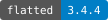
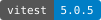
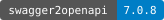

## Webpage: [operations.superduper.solutions](https://operations.superduper.solutions)

A browser-based platform for composing OpenAPI operations into reusable workflows.

Settings includes a [browser-local Bonsai assistant](docs/browser-assistant.md)
for inspecting the application and arranging workflows without running them.

> [!NOTE]
> This project is under active development and is currently in a pre-release state.

## npm commands

<code>npm ci</code>

- **Purpose:** Install locked dependencies.
- **Requirements:** Use the Node.js and npm versions declared in [`package.json`](package.json).

<code>npm run badges:coverage</code>

- **Purpose:** Generate the source-coverage badge under `tmp/test/badges`.
- **Requirements:** Requires Bash, jq and a fresh `npm run test:source:coverage` followed by
  `npm run test:coverage`.

<code>npm run badges:dependencies</code>

- **Purpose:** Update dependency-version badges.
- **Requirements:** Requires Bash, jq and current dependency versions in `package.json`.

<code>npm run badges:scenarios</code>

- **Purpose:** Generate the test-scenario badge under `tmp/test/badges`.
- **Requirements:** Requires Bash, jq and fresh, complete results from all six Gherkin suites.

<code>npm run build</code>

- **Purpose:** Verify favicon freshness and build the embedded application,
  hosting headers and browser icon compatibility files in `dist`.
- **Requirements:** Run `npm ci` first.

<code>npm run dev</code>

- **Purpose:** Start the local development server.
- **Requirements:** Run `npm ci` first.
- **Guidance:** [Diagnostics and error reporting](docs/adr/error-view.md),
  and [startup progress and loading preview](docs/adr/dedicated-workers.md#startup-progress).

<code>npm run icons:generate</code> / <code>npm run icons:check</code>

- **Purpose:** Generate favicon compatibility files from the original SVG, or
  check their byte-for-byte freshness without writing.
- **Requirements:** Run `npm ci` first and use the pinned Node.js/npm versions.
- **Guidance:** [Bundled assets](src/assets/README.md).

<code>npm run report:tests</code>

- **Purpose:** Merge Vitest results into `tmp/test/report/`, including coverage and attachments.
- **Requirements:** Run `npm ci` first. Complete, unfiltered results, execution proofs and
  coverage from all six suites are required; merging does not rerun tests.

<code>npm run test:acceptance</code>

- **Purpose:** Check the built output.
- **Requirements:** Run `npm ci` and `npm run build` first.

<code>npm run test:automation</code>

- **Purpose:** Check repository automation without deploying.
- **Requirements:** Run `npm ci` first. Bash, Git 2.45+ and jq are required.

<code>npm run test:browser</code>

- **Purpose:** Run application browser scenarios and Svelte component scenarios in Chromium.
  Focused browser selections run only the selected application scenarios.
- **Requirements:** Run `npm ci` and `npm run build` first. Bash and running Docker are required.

<code>npm run test:components</code>

- **Purpose:** Check Svelte state, bindings, props and cleanup through Gherkin in Vitest Browser Mode.
- **Requirements:** Run `npm ci` first and provide matching Playwright browser binaries.
  The unfiltered `test:browser` command runs these cases in its pinned container.

<code>npm run test:coverage</code>

- **Purpose:** Check the generated coverage summary against 100% statement, branch,
  function and line requirements; this command does not rerun tests.
- **Scope:** Node-executable application logic; see [Testing, coverage and reporting](docs/adr/test-suite-reports.md)
  for the scope and exclusions.
- **Requirements:** Collect fresh coverage with `npm run test:source:coverage` first.

<code>npm run test:runner</code>

- **Purpose:** Check Gherkin discovery, scenario identities, cancellation, cleanup and report evidence.
- **Requirements:** Run `npm ci` first.

<code>npm run test:source</code>

- **Purpose:** Run source behavior and unit scenarios through QuickPickle and Vitest,
  recording each case in `tmp/test/vitest-source.json`.
- **Requirements:** Run `npm ci` first.

<code>npm run test:source:coverage</code>

- **Purpose:** Run source Gherkin scenarios and collect V8 coverage in `tmp/test/coverage/`.
- **Requirements:** Run `npm ci` first.

<code>npm run typecheck</code>

- **Purpose:** Check Svelte components and TypeScript source.
- **Requirements:** Run `npm ci` first.

<code>npm test</code>

- **Purpose:** Run the acceptance suite only; alias for `npm run test:acceptance`.
- **Requirements:** Run `npm ci` and `npm run build` first.

## Development status

Creates releases from `develop` and validates and previews release and hotfix
pull requests before merging into `main`. Continues in the same release run to
tag and deploy, publish the combined test and coverage report, and synchronize
released changes back to `develop`.

---

Checks branch policy, script linting, types and build output before merging into
`develop`, then updates the development preview. Test suites run on `develop`
only through the manual **test-develop** workflow; release candidates run them
automatically before release.

## Quality Assurance

Badges and linked reports describe the latest successfully published release.

Test coverage of the application behavior, build output, and release automation,
showing which expected outcomes are verified and which scenarios fail, with
details to help investigate regressions.

---

Code coverage of the measured application source, showing which statements,
branches, functions, and lines are exercised by tests and where additional
tests are needed.

## Dependency packages

Publishes and restores verified test feature checkpoints in GitHub Actions so
CI retries can reuse successful work.

---

Provide the browser assistant's streaming agent loop, native tool transcript,
validated tool execution and progressive skill reads. Inference uses the pinned
WebML adapter; no hosted model provider is selected.

---

Provide the comment editor's Markdown syntax highlighting, document state,
selection, keyboard commands and editing view.

---

Render stored Markdown with shared extensions for footnotes, images, inserted
and highlighted text, subscripts, superscripts and task lists.

---

Parses Gherkin features and scenario-outline examples. Independent case discovery
checks that the combined report contains every declared scenario.

---

Provides the Gherkin message types and identifiers used when parsing features
and preserving canonical scenario and example-row locations.

---

Reads and rewrites Vitest blob references when results move between CI jobs,
so reports retain attachments and coverage without changing the original evidence.

---

Registers Gherkin scenarios and steps with Vitest. The maintained local package
in `tests/gherkin/quickpickle` preserves example identities, cancellation, cleanup
and failure details needed by the shared report.

---

Executes all Gherkin suites and produces mergeable results. Its built-in HTML
report presents scenario outcomes, diagnostics and coverage in one report.

---

Provides the built-in Vitest HTML interface used to browse the combined results.
Publish the complete report directory with its metadata and assets.

---

Measures V8 coverage within the explicit application scope, including unexecuted
files. Release validation requires 100% statements, branches, functions and lines.

---

Connects Vitest Browser Mode to Playwright for Gherkin component scenarios
using native browser interactions.

---

Mounts, updates and unmounts Svelte components in Vitest Browser Mode while
retaining native bindings and lifecycle cleanup.

---

Provides accessible dialog, select, popover, and tooltip primitives used by the
webpage’s shared controls and `shadcn-svelte` sheet components.

---

Provides the Node.js `Buffer` API that `isomorphic-git` needs to read and write
binary Git data in the browser. LightningFS stores the resulting repository
files locally in IndexedDB.

---

Supports the webpage’s UI styling, combining default and custom `Tailwind CSS`
classes in `shadcn-svelte` components and resolving conflicts.

---

Derives password wrapping keys with Argon2id inside the dedicated secrets
worker. Web Crypto encrypts the browser-local vault; the password and derived
key are never persisted.

---

Provides promise-based IndexedDB access for settings, workflow and schema
catalogues, storage inspection, and database migrations.

---

Creates and reads local Git history for workflows, uploaded schemas, and recorded
resource metrics, using the LightningFS filesystem. Each workflow and uploaded
schema has its own repository.

---

Provides the IndexedDB-backed filesystem that stores repository working files
and Git metadata in the browser.

---

Retained for optional SVG icons in Svelte components. The main interface uses
locally bundled, filled Material Symbols Rounded, documented with their license
in [`src/assets/fonts`](src/assets/fonts/README.md).

---

Provides the optional development toolbar with timing, performance, and Vite
configuration panels. It is excluded from production builds.

---

Formats object details when normalizing development runtime errors.

---

Provides scoped logging for the application, workers, development server, scripts,
and tests. The browser reporter preserves native errors and forwards application
errors to the development overlay.

---

Displays themed development errors with source frames and their cause chains.

---

Parses uploaded CSV data in a dedicated worker, supporting delimiter detection,
quoted multiline cells and configurable headers. `@types/papaparse` supplies its
TypeScript definitions during development.

---

Checks the webpage in Chromium through Gherkin scenarios, using Playwright's
browser controls and assertions to verify user interactions and responsive
layout. Captures screenshots and traces to explain browser test failures.

---

Bundles external schema references into the checked-in service packs during an
explicit refresh. Ordinary builds do not download provider schemas.

---

Converts Swagger 2 service descriptions to OpenAPI 3 during schema refresh.
It is development tooling and is not shipped in the browser runtime.

---

Generates checked-in favicon compatibility files from the original SVG during
development. It is build tooling and is not included in the browser application.

---

Provides the webpage’s component framework and reactive state, supporting the
workflow editor, navigation, and shared UI components.

---

Checks the webpage’s `Svelte` components and `TypeScript` source for errors,
allowing the integration and release workflows to catch type and component
problems before building.

---

Connects the webpage’s `Svelte` components to the `Vite` build, compiling the
workflow editor, navigation, and controls into browser JavaScript and CSS.

---

Defines the webpage’s reusable component styles through its `shadcn-svelte`
button and sheet components, providing typed variants for button appearance,
size, and sheet placement.

---

Provides the webpage’s utility classes and shared theme tokens, used by its
`shadcn-svelte` components for layout, styling, colors, and corner radii.

---

Integrates the webpage’s `Tailwind CSS` styles with the `Vite` build, generating
the utilities and theme styles used by its buttons and navigation sheet.

---

Supports motion in the webpage’s `shadcn-svelte` navigation sheet, providing the
slide and fade animations used when the panel and its overlay open and close.

---

Provides the type system used by the webpage’s application code and `Svelte`
components, with `svelte-check` validating workflow data, connections, and
component properties before integration or release.

> [!NOTE]
> The upgrade to TypeScript 7 is pending compatibility support by the `svelte-check` package.
> The badge below tracks the upstream issue’s status and links to progress updates.
>
> 

---

Builds the webpage for deployment by combining application code, `Svelte`
components, and styles. Coordinates the `Svelte`, `Tailwind CSS`, and single-file
plugins used to produce the release build.

---

Packages the webpage for deployment as one HTML file with embedded JavaScript
and CSS. The bundle also includes Cloudflare Pages `_headers` and nine favicon
compatibility files; acceptance and deployment checks verify this exact set.

---

Provides the webpage’s workflow canvas, with draggable nodes, connection handles
and edges, and controls for navigating the diagram.

---

Supplies Svelte Flow's measured handle geometry to the workflow connection router,
so previews and completed arrows meet the same endpoints.

---

Parses uploaded OpenAPI documents in YAML 1.2 format, converting their contents
into JSON-compatible values for schema validation and operation discovery.
