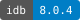
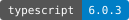

## Webpage: [operations.superduper.solutions](https://operations.superduper.solutions)

A browser-based platform for composing OpenAPI operations into reusable workflows.

> [!NOTE]
> This project is under active development and is currently in a pre-release state.

## npm commands

<code>npm ci</code>

- **Purpose:** Install locked dependencies.
- **Requirements:** Use the Node.js and npm versions declared in [`package.json`](package.json).

<code>npm run badges:coverage</code>

- **Purpose:** Generate the source-coverage badge under `tmp/test/badges`.
- **Requirements:** Requires Bash, jq and a fresh `npm run test:source:coverage` followed by
  `npm run test:coverage`.

<code>npm run badges:dependencies</code>

- **Purpose:** Update dependency-version badges.
- **Requirements:** Requires Bash, jq and current dependency versions in `package.json`.

<code>npm run badges:scenarios</code>

- **Purpose:** Generate the test-scenario badge under `tmp/test/badges`.
- **Requirements:** Requires Bash, jq and fresh, complete results from all four test suites.

<code>npm run build</code>

- **Purpose:** Verify favicon freshness and build the embedded application,
  hosting headers and browser icon compatibility files in `dist`.
- **Requirements:** Run `npm ci` first.

<code>npm run dev</code>

- **Purpose:** Start the local development server.
- **Requirements:** Run `npm ci` first.
- **Guidance:** [Diagnostics and error reporting](docs/adr/error-view.md),
  and [startup progress and loading preview](docs/adr/dedicated-workers.md#startup-progress).

<code>npm run icons:generate</code> / <code>npm run icons:check</code>

- **Purpose:** Generate favicon compatibility files from the original SVG, or
  check their byte-for-byte freshness without writing.
- **Requirements:** Run `npm ci` first and use the pinned Node.js/npm versions.
- **Guidance:** [Bundled assets](src/assets/README.md).

<code>npm run report:coverage</code>

- **Purpose:** Package the generated coverage report into the standalone `tmp/test-coverage.html`.
- **Requirements:** Run `npm ci`, `npm run test:source:coverage` and `npm run test:coverage` first.

<code>npm run report:tests</code>

- **Purpose:** Generate the combined `tmp/test-report.html`.
- **Requirements:** Run `npm ci` first. Fresh, complete results from all four test suites are required.

<code>npm run test:acceptance</code>

- **Purpose:** Check the built output.
- **Requirements:** Run `npm ci` and `npm run build` first.

<code>npm run test:acceptance:coverage</code>

- **Purpose:** Run acceptance scenarios and collect coverage data.
- **Requirements:** Run `npm ci` and `npm run build` first.

<code>npm run test:automation</code>

- **Purpose:** Check repository automation without deploying.
- **Requirements:** Run `npm ci` first. Bash, Git and jq are required.

<code>npm run test:browser</code>

- **Purpose:** Run browser scenarios in Chromium.
- **Requirements:** Run `npm ci` and `npm run build` first. Bash and running Docker are required.

<code>npm run test:coverage</code>

- **Purpose:** Generate reports in `tmp/test/coverage/` and enforce 100% statement, branch,
  function and line coverage.
- **Scope:** Node-executable application logic; see [Testing, coverage and reporting](docs/adr/test-suite-reports.md)
  for the scope and exclusions.
- **Requirements:** Collect fresh coverage with `npm run test:source:coverage` first.

<code>npm run test:source</code>

- **Purpose:** Run all source behavior and unit scenarios through Cucumber,
  recording each result in `tmp/test/cucumber-source.json`.
- **Requirements:** Run `npm ci` first.

<code>npm run test:source:coverage</code>

- **Purpose:** Run all source Cucumber scenarios and collect coverage data.
- **Requirements:** Run `npm ci` first.

<code>npm run typecheck</code>

- **Purpose:** Check Svelte components and TypeScript source.
- **Requirements:** Run `npm ci` first.

<code>npm test</code>

- **Purpose:** Run the acceptance suite only; alias for `npm run test:acceptance`.
- **Requirements:** Run `npm ci` and `npm run build` first.

## Development status

Creates releases from `develop` and validates and previews release and hotfix
pull requests before merging into `main`. Continues in the same release run to
tag and deploy, publish test and coverage reports, and synchronize released
changes back to `develop`.

---

Checks branch policy, script linting, types and build output before merging into
`develop`, then updates the development preview. Test suites run on `develop`
only through the manual **test-develop** workflow; release candidates run them
automatically before release.

## Quality Assurance

Badges and linked reports describe the latest successfully published release.

Test coverage of the application behavior, build output, and release automation,
showing which expected outcomes are verified and which scenarios fail, with
details to help investigate regressions.

---

Code coverage of the measured application source, showing which statements,
branches, functions, and lines are exercised by tests and where additional
tests are needed.

## Dependency packages

Provides accessible dialog, select, popover, and tooltip primitives used by the
webpage’s shared controls and `shadcn-svelte` sheet components.

---

Provides the Node.js `Buffer` API that `isomorphic-git` needs to read and write
binary Git data in the browser. LightningFS stores the resulting repository
files locally in IndexedDB.

---

Supports application testing by measuring source code coverage and generating
coverage reports. The release workflow uses its coverage checks to enforce
requirements and block releases that leave measured code untested.

---

Supports the webpage’s UI styling, combining default and custom `Tailwind CSS`
classes in `shadcn-svelte` components and resolving conflicts.

---

Supports application and CI validation by running source, acceptance, browser,
and automation scenarios defined in `Gherkin`, producing the results used by the
combined test report.

---

Derives password wrapping keys with Argon2id inside the dedicated secrets
worker. Web Crypto encrypts the browser-local vault; the password and derived
key are never persisted.

---

Provides promise-based IndexedDB access for settings, workflow and schema
catalogues, storage inspection, and database migrations.

---

Creates and reads local Git history for workflows, uploaded schemas, and recorded
resource metrics, using the LightningFS filesystem. Each workflow and uploaded
schema has its own repository.

---

Provides the IndexedDB-backed filesystem that stores repository working files
and Git metadata in the browser.

---

Retained for optional SVG icons in Svelte components. The main interface uses
locally bundled, filled Material Symbols Rounded, documented with their license
in [`src/assets/fonts`](src/assets/fonts/README.md).

---

Provides the optional development toolbar with timing, performance, and Vite
configuration panels. It is excluded from production builds.

---

Formats object details when normalizing development runtime errors.

---

Provides scoped logging for the application, workers, development server, scripts,
and tests. The browser reporter preserves native errors and forwards application
errors to the development overlay.

---

Displays themed development errors with source frames and their cause chains.

---

Supports release quality review by generating the combined test report from
source, acceptance, browser, and automation results, with scenario outcomes and failure
details.

---

Parses uploaded CSV data in a dedicated worker, supporting delimiter detection,
quoted multiline cells and configurable headers. `@types/papaparse` supplies its
TypeScript definitions during development.

---

Checks the webpage in Chromium through Cucumber scenarios, using Playwright's
browser controls and assertions to verify user interactions and responsive
layout. Captures screenshots and traces to explain browser test failures.

---

Generates checked-in favicon compatibility files from the original SVG during
development. It is build tooling and is not included in the browser application.

---

Provides the webpage’s component framework and reactive state, supporting the
workflow editor, navigation, and shared UI components.

---

Checks the webpage’s `Svelte` components and `TypeScript` source for errors,
allowing the integration and release workflows to catch type and component
problems before building.

---

Connects the webpage’s `Svelte` components to the `Vite` build, compiling the
workflow editor, navigation, and controls into browser JavaScript and CSS.

---

Defines the webpage’s reusable component styles through its `shadcn-svelte`
button and sheet components, providing typed variants for button appearance,
size, and sheet placement.

---

Provides the webpage’s utility classes and shared theme tokens, used by its
`shadcn-svelte` components for layout, styling, colors, and corner radii.

---

Integrates the webpage’s `Tailwind CSS` styles with the `Vite` build, generating
the utilities and theme styles used by its buttons and navigation sheet.

---

Supports motion in the webpage’s `shadcn-svelte` navigation sheet, providing the
slide and fade animations used when the panel and its overlay open and close.

---

Provides the type system used by the webpage’s application code and `Svelte`
components, with `svelte-check` validating workflow data, connections, and
component properties before integration or release.

> [!NOTE]
> The upgrade to TypeScript 7 is pending compatibility support by the `svelte-check` package.
> The badge below tracks the upstream issue’s status and links to progress updates.
>
> 

---

Builds the webpage for deployment by combining application code, `Svelte`
components, and styles. Coordinates the `Svelte`, `Tailwind CSS`, and single-file
plugins used to produce the release build.

---

Packages the webpage for deployment as one HTML file with embedded JavaScript
and CSS. The bundle also includes Cloudflare Pages `_headers` and nine favicon
compatibility files; acceptance and deployment checks verify this exact set.

---

Provides the webpage’s workflow canvas, with draggable nodes, connection handles
and edges, and controls for navigating the diagram.

---

Supplies Svelte Flow's measured handle geometry to the workflow connection router,
so previews and completed arrows meet the same endpoints.

---

Parses uploaded OpenAPI documents in YAML 1.2 format, converting their contents
into JSON-compatible values for schema validation and operation discovery.
