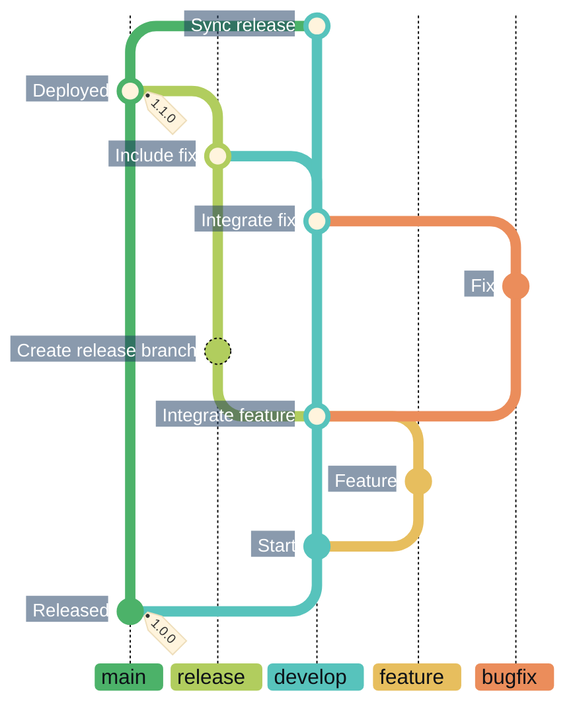
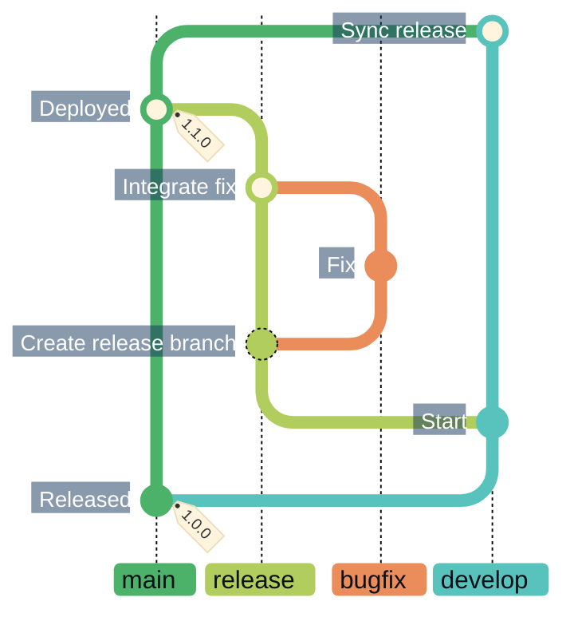
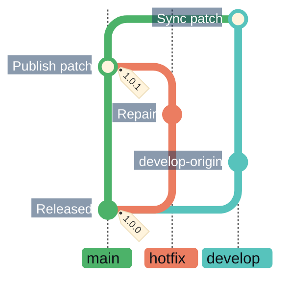
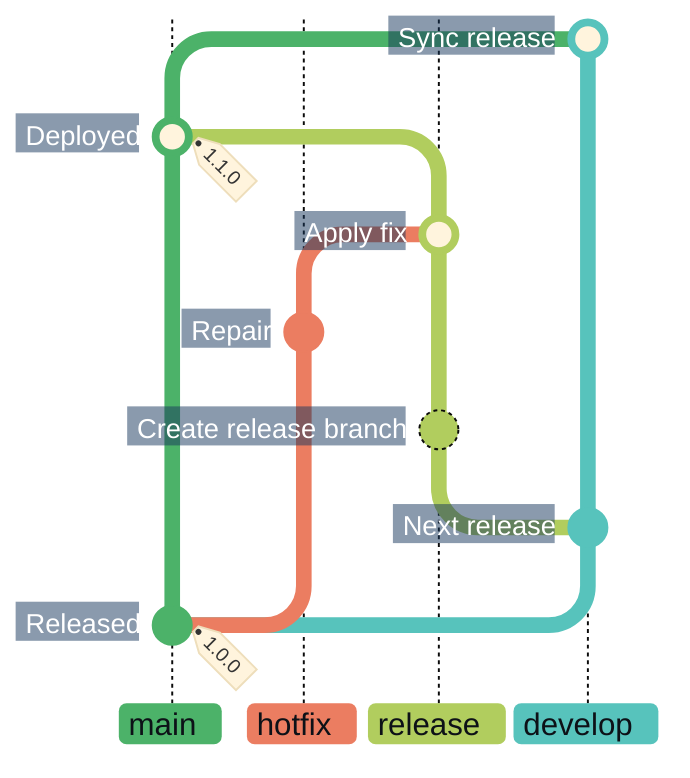
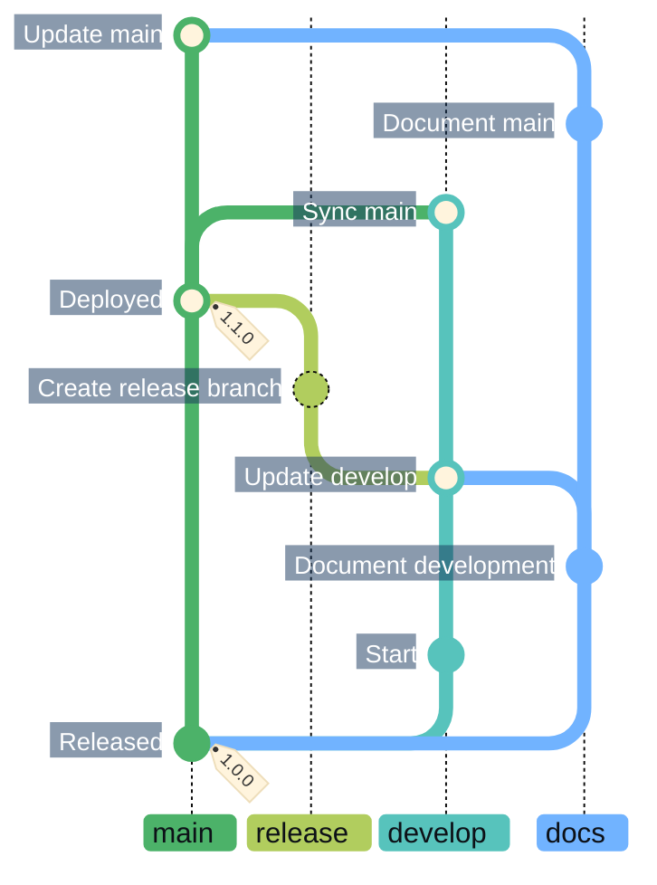

# CICD

> [!IMPORTANT]
> Continuous integration and deployment follow a Gitflow branch strategy, with automated tests that help assure quality between development cycles and deployments.

## Development to release

The [AVH git-flow model](https://github.com/petervanderdoes/gitflow-avh) separates
ongoing work in `develop` from releases in `main`. Versions follow
[Semantic Versioning](https://semver.org/).

Read the diagrams **from bottom to top**. Branch labels omit topic and version
suffixes.

### Branching

`feature/*` and integration `bugfix/*` branches start from and return to `develop`
through PRs. A `release/<version>` branches from `develop` after feature
integration and incorporates current `main`.

The overview's `develop` → `release` update is not yet supported by CI branch
validation.

Stabilization fixes use `bugfix/*` branches from the active release and return
to that release through a PR.

The fix is validated before merging into the release. After release validation,
`release` merges into `main`; a synchronization PR then carries `main` back into
`develop`.

### Validation and publication

Releases, including hotfixes, require a fully passing test suite and all required
checks. Protected branches enforce checks tied to the tested revision. CI merges
and tags the verified revision, deploys its tested artifacts, and opens a
`main` → `develop` synchronization PR.

### Merge policy

Feature and integration bugfix PRs, hotfix PRs into `main`, and documentation PRs
fast-forward when they contain one commit and the target is its ancestor;
otherwise they squash. Release stabilization, publication and synchronization
fast-forward where possible; otherwise they use merge commits.

## Hotfixes

A `hotfix/<version>` branches from released `main` using the next patch version,
allowing a production fix without waiting for the next release.

After validation, the hotfix merges into `main` and receives its patch version
tag. A synchronization PR then carries `main` into `develop`.

### Including a hotfix in the next release

A hotfix can instead be included in an active release.

The hotfix merges into `release` without creating a separate tag. The validated
release then merges into `main` and receives its release version tag. A
`main` → `develop` synchronization PR follows.

## Updating documentation

`docs/<topic>` PRs update Markdown on explicitly selected `develop` or `main`
targets.

### Branch reuse

Here, a docs branch from `main` targets `develop` first, then `main` after a
release. Later edits retain earlier documentation changes; reliable branch reuse
across targets remains planned automation work.

### Validation and automation

Each target validates the full Markdown-only change set. Docs PRs skip
application tests and builds. They do not create release versions or tags,
publish releases, deploy, or open synchronization PRs—including `main` → `develop`.
Each target needs its own explicitly requested PR.
