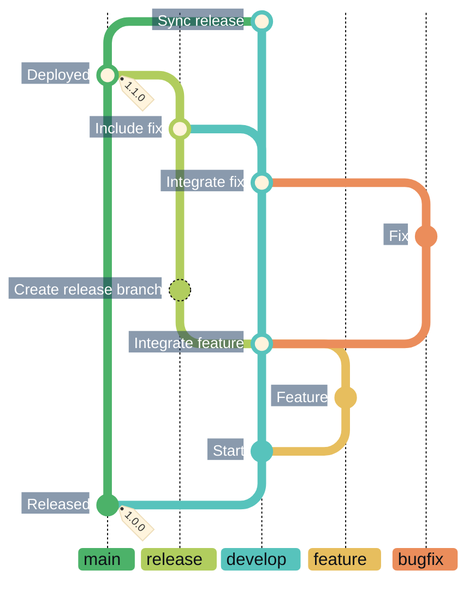
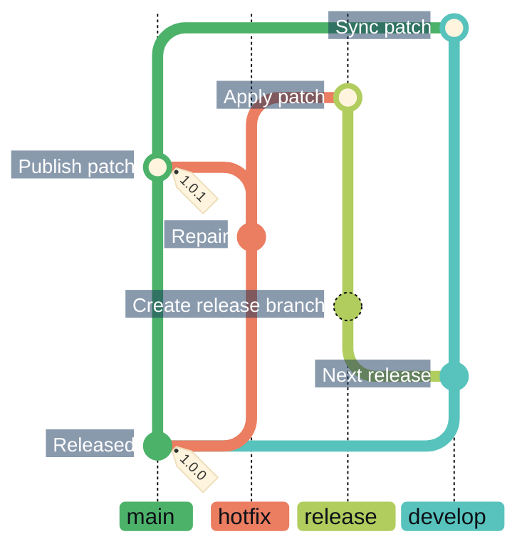
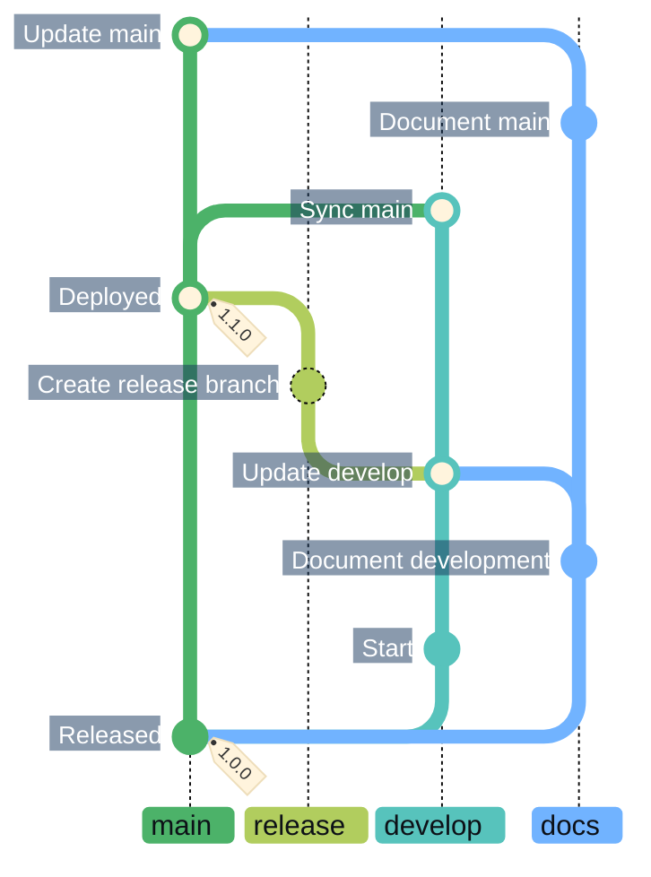

# Continuous integration and deployment follow Gitflow, with a fully passing test suite required for release

Development and releases follow the
[AVH git-flow model](https://github.com/petervanderdoes/gitflow-avh) with
[Semantic Versioning](https://semver.org/). `develop` integrates ongoing work;
`main` contains releases. This separation lets development continue while a
release is stabilized.

Releases require a fully passing test suite and all required validation.
Publication uses the verified release revision and build artifacts from that
validation run, preserving the connection between what was tested and what
users receive.

CI automates validation, merging, tagging, deployment and branch synchronization.
Protected branches and checks tied to the tested revision guard against
publishing unvalidated changes.

Markdown-only changes have a separate, strictly checked documentation path.
They skip application tests, builds and publication because they cannot change
the application.

## Branches and merge paths

| Branch | Role and starting point |
|---|---|
| `main` | Released code. |
| `develop` | Integration of ongoing work. |
| `feature/*` | New work, starting from `develop`. |
| `bugfix/*` | Fixes starting from `develop` or the active release, returning to that same branch. |
| `release/<version>` | Release preparation from `develop`, incorporating current `main`. |
| `hotfix/<version>` | Patch fixes starting from released `main`. |
| `docs/*` | Markdown-only updates with explicitly selected targets; see [documentation paths](#updating-documentation). |

Read each graph **from bottom to top**. Each example shows one part of the
branching model. Branch labels omit topic and version suffixes; commit labels
explain the work and where it is integrated.

### Development to release

Features and integration fixes return to `develop`. A release branches from
`develop` after feature integration and incorporates later fixes before
publication to `main`. After publication, `main` is merged back into `develop`.

The illustrated `develop` → `release` update is not yet supported by
[CI branch validation](../../.github/scripts/validate-pr.sh).

### Fixing production during a release

A hotfix starts from released `main` and also carries the fix into the active
release. Once published and tagged, `main` is synchronized into `develop`.

### Updating documentation

One `docs/<topic>` branch carries two successive documentation edits, merged
into `develop` and `main` through explicitly selected PRs. The release branches
from `develop` after the first documentation merge, is validated and merged into
`main`, then `main` is merged back into `develop`. The second docs edit goes to
`main` afterward.

The shared docs branch starts from `main` and accumulates only documentation
changes; each later edit includes the earlier ones. Every target must pass the
full Markdown-only check. Reliable branch reuse across targets remains planned
automation work. The documentation workflow itself does not publish releases or
synchronize target branches.

### Merge methods

- Feature, integration bugfix, production hotfix and documentation PRs
  fast-forward when they contain one commit and the target is its ancestor;
  otherwise they squash.
- Release stabilization, publication and synchronization fast-forward where
  possible; otherwise they use a merge commit to preserve history.

Mermaid draws each [integration as a merge commit](https://mermaid.js.org/syntax/gitgraph.html#merging-two-branches);
the policies above determine the actual Git history. Each documentation PR
targets one branch explicitly, without automatic synchronization.

See [Repository automation](../../.github/workflows/README.md) for branch rules,
merge methods, contributor procedures and publication details.
