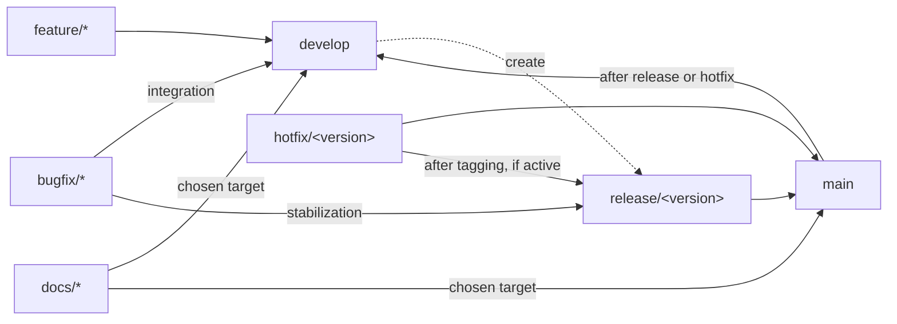

# Continuous integration and deployment follow Gitflow, with a fully passing test suite required for release

Development and releases follow the
[AVH git-flow model](https://github.com/petervanderdoes/gitflow-avh) with
[Semantic Versioning](https://semver.org/). `develop` integrates ongoing work;
`main` contains releases. This separation lets development continue while a
release is stabilized.

Releases require a fully passing test suite and all required validation.
Publication uses the verified release revision and build artifacts from that
validation run, preserving the connection between what was tested and what
users receive.

CI automates validation, merging, tagging, deployment and branch synchronization.
Protected branches and checks tied to the tested revision guard against
publishing unvalidated changes.

Markdown-only changes have a separate, strictly checked documentation path.
They skip application tests, builds and publication because they cannot change
the application.

## Branches and merge paths

| Branch | Role and starting point |
|---|---|
| `main` | Released code. |
| `develop` | Integration of ongoing work. |
| `feature/*` | New work, starting from `develop`. |
| `bugfix/*` | Fixes starting from `develop` or the active release, returning to that same branch. |
| `release/<version>` | Release preparation from `develop`, incorporating current `main`. |
| `hotfix/<version>` | Patch fixes starting from released `main`. |
| `docs/*` | Markdown changes starting from the explicitly chosen `develop` or `main` target. |

Solid arrows show merges or synchronization; the dashed arrow creates a branch.

Each documentation branch merges only into its chosen target; the two paths are
alternatives, with no automatic synchronization.

See [Repository automation](../../.github/workflows/README.md) for branch rules,
merge methods, contributor procedures and publication details.
