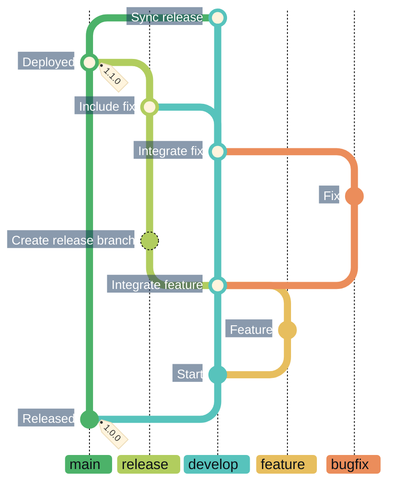
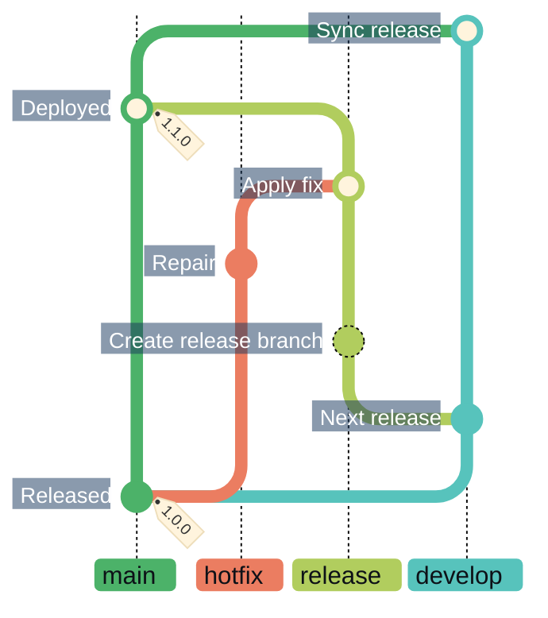
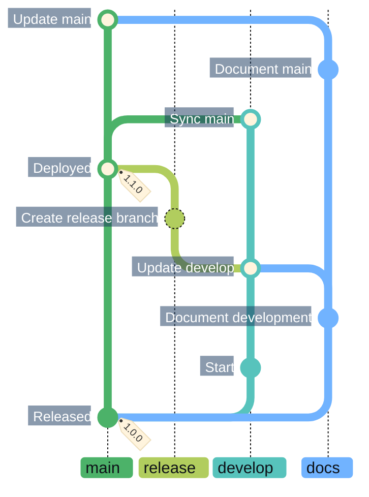

# CICD

> [!IMPORTANT]
> Continuous integration and deployment follow a Gitflow branch strategy, with automated tests that help assure quality between development cycles and deployments.

## Development to release

Development and releases follow the
[AVH git-flow model](https://github.com/petervanderdoes/gitflow-avh) with
[Semantic Versioning](https://semver.org/). `develop` integrates ongoing work;
`main` contains releases. This separation lets development continue while a
release is prepared.

Read all four diagrams **from bottom to top**. Branch labels omit topic and
version suffixes; commit labels explain the work and its integration.

New work starts on `feature/*` branches from `develop`. Integration fixes use
`bugfix/*` branches from `develop`; both return through PRs. A `release/<version>`
branch starts from `develop` after feature integration, incorporates current
`main`, and collects later fixes before publication. Stabilization fixes use
`bugfix/*` branches from the active release and return to that release.

Every release, including a hotfix, requires a fully passing test suite and all
required validation. CI automates validation, merging, tagging, deployment and
synchronization. Protected branches and checks tied to the tested revision guard
publication. The verified revision and its tested artifacts are published
together. After publication to `main`, a synchronization PR carries `main` back
into `develop`.

Feature and integration bugfix PRs fast-forward when they contain one commit and
the target is its ancestor; otherwise they squash. Release stabilization,
publication and synchronization fast-forward where possible; otherwise they use
a merge commit to preserve history. Mermaid draws every
[integration as a merge commit](https://mermaid.js.org/syntax/gitgraph.html#merging-two-branches);
the merge policies described here determine the actual Git history.

The illustrated `develop` → `release` update is not yet supported by
[CI branch validation](../../.github/scripts/validate-pr.sh). See
[Repository automation](../../.github/workflows/README.md) for the operational
branch rules, contributor procedures and publication details.

## Hotfixes

A production fix starts on `hotfix/<version>` from released `main`, using the
next patch version. It can be published without waiting for the next release.

After validation, the hotfix merges back into `main` and receives its patch
version tag. A synchronization PR from `main` to `develop` then carries the
published fix into ongoing development.

A hotfix PR into `main` fast-forwards when it contains one commit and the target
is its ancestor; otherwise it squashes. Publication and synchronization follow
the validation and merge policies described above.

---

### Including a hotfix in the next release

A hotfix can also enter an active release. This example shows the fix reaching
production through that release.

The hotfix merges into `release`, then the validated release merges into `main`
and receives its release version tag. Synchronization from `main` to `develop`
follows publication. The hotfix-to-release merge does not create a separate tag.
These merges fast-forward where possible; otherwise merge commits preserve
the release history.

## Updating documentation

A `docs/<topic>` branch contains Markdown-only updates for explicitly selected
`develop` or `main` PRs. This example reuses one docs branch for two successive
edits.

The first docs edit enters `develop` and is included in a normal release. After
that release reaches `main` and is synchronized into `develop`, the second docs
edit goes directly to `main`.

The shared docs branch starts from `main` and retains its earlier documentation
changes. Every target must pass the full Markdown-only check; reliable branch
reuse across targets remains planned automation work. This restricted path skips
application tests and builds because it cannot change the application.
Documentation PRs fast-forward when they contain one commit and the target is
its ancestor; otherwise they squash.

Documentation merges do not create release versions or tags, publish releases,
or trigger deployments. A docs PR merged into `main` does not open a
synchronization PR to `develop`; each target requires its own explicitly
requested PR.
