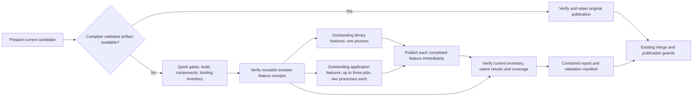

# Resumable CI validation

GitHub Actions retains each successful browser feature so a correction can run
only the features whose execution inputs changed. Cold validation distributes
outstanding features over at most four GitHub-hosted jobs. This changes test
orchestration; all authored scenarios, examples, assertions and hooks remain
required.

The [CI ADR](adr/continuous-integration.md) controls branch and merge policy.
The [test reporting ADR](adr/test-suite-reports.md) controls completeness and
coverage. The historical investigation is in
[CI test orchestration](ci-test-orchestration.md).

## Workflow

`validation-prepare` builds once, runs the small complete profiles and prepares
browser fixtures once. It verifies cache candidates before constructing the
matrix. A batch with no outstanding features starts no GitHub job. The final
`application` check retains its existing name and requires successful quick
gates, completed browser batches when needed, and verified results for every
current case. A skipped or failed dependency cannot become a passing aggregate.

| Route | Required work |
| --- | --- |
| Automatic integration into develop | Existing static checks and preview build; no automatic test expansion |
| Release/main validation | All six profiles and all scoped 100% coverage thresholds |
| Support integration | Existing source, runner, acceptance, component and browser gates; no new release certification |
| Manual develop tests | All six profiles and scoped coverage, explicitly dispatched on develop |

## Feature identity and invalidation

A complete feature file is the reusable browser unit. A fresh Node process
loads only the definitions and hooks selected by full-registry discovery.
Before execution, scoped discovery must reproduce those exact bindings. Browser
resources remain owned by the worker, with a fresh context for each scenario.
Shared helper exports live in fixture modules instead of importing unrelated
step registrations.

The input key includes feature bytes, actual step/helper dependencies and
bindings, application/build inputs, built application bytes, prebuilt fixtures,
runner and policy files, installed toolchain, immutable browser image and
runtime/capture settings. Unknown native dynamic imports conservatively include
all browser modules. Eager registration side effects remain global inputs.

Commit SHA, global feature inventory, job placement and duration estimates are
provenance or scheduling data, rather than part of an individual feature key.
Adding a feature using existing definitions therefore retains unchanged keys.
The source inventory is separately stored in `tests/source-profile.json`, so
adding a source case does not alone discard browser evidence. Changing runtime
application code, dependencies or shared runner configuration invalidates all
affected browser features; this initial implementation assumes application
changes affect the whole browser corpus.

## Reuse and recovery

Only the same repository and PR can contribute cached feature results. Candidate
runs must belong to an approved validation workflow, with verified GitHub PR
association and artifact identity. A matching branch name is insufficient.
GitHub sometimes omits run PR metadata; the lookup then checks the commit's
associated PRs. Lookups have a two-minute budget, inspect at most ten recent
runs, and treat unavailable or invalid evidence as a cache miss.

Receipts retain the original commit, workflow, run, attempt and execution times.
They expire **seven days after original completion**; downloading or repacking
them does not renew that age. A failed or cancelled workflow may contribute a
feature that completed and published successfully before the failure. Missing
or unpublished work must execute. Tag a feature or case `@ci-fresh` when it must
execute again on a new run; failed-job recovery within the same run remains
available.

On a new commit, cheap profiles run in full again. GitHub's **Re-run failed
jobs** keeps successful sibling jobs and their evidence. A retried browser batch
checks current-run checkpoints first and executes only its outstanding features.
Do not manually rerun a failed scenario and call the whole feature complete.

A receipt is sealed after the child process exits successfully. Verification
requires all authored cases and steps, matching native JSON/blob results,
successful worker cleanup, unchanged inputs, and hashes of every retained
output. Arbitrary feature/name/tag selectors still produce incomplete profile
proofs. The separate unit receipt and final inventory verifier provide CI
certification without relabelling filtered output as a full profile run.

Readonly browser validation checks the live PR every 30 seconds. Changed inputs
stop its owned processes and preserve published checkpoints. A regular root
`CHANGELOG.md` update may continue only when all other root tree entries match.
The existing integration queue and merge/publication locks remain in effect.

## Resources, reports and controls

Each browser job uses the public runner's four-CPU, 16-GB job profile. Its
Docker container uses up to four available CPUs and 14 GiB RAM, reserving 2 GiB
of physical host memory for the OS, Actions runner and artifact controller.
Smaller hosts receive a smaller allocation; insufficient capacity stops before
container startup. Both browser launchers share this policy. The declared policy
is part of feature cache identity, and batch metrics record the actual allocation.
Containers allow no extra swap and at most 512 processes. Application batches
run at most two feature processes; the library batch runs one. Node heaps are capped at
512 MiB per process. Source is mounted read-only, container networking is
disabled, and GitHub artifact credentials stay on the host.

Set `OPERATIONS_TEST_RESOURCE_PROFILE=ci` to use the same browser allocation
outside GitHub, including Swarm evaluations, without pretending to run in
GitHub Actions. A Swarm job may reserve the full four-CPU/16-GiB job budget on
its shared host; recheck capacity before launch. The ordinary desktop launcher
keeps its smaller two-CPU/2-GiB ceiling.

Swarm service swap limits count additional swap bytes: use
`docker service create --memory-swap=0` and verify `memory.swap.max=0` before
executing a workload. The `docker run` flag instead counts combined RAM and
swap, so its no-swap setting remains equal to the RAM limit. See the
[service resource options](https://docs.docker.com/reference/cli/docker/service/create/)
and [container memory/swap semantics](https://docs.docker.com/engine/containers/resource_constraints/#--memory-swap-details).

Successful feature artifacts use immutable `ci-unit-v1-*` names. Failed features
have separate `ci-failure-v1-*` diagnostics. Final reports combine native blobs,
retain original feature receipts and raw evidence, and identify newly executed
and reused browser case counts. Schema 3 permits those original browser
producers and earlier successful quick-profile attempts from the same run and
revision. Schema 2 complete-validation artifacts remain supported. Neither a
diagnostic report nor a partial set can certify integration.

Ordinary incremental browser cases retain action traces, failure screenshots,
console/network errors and cleanup diagnostics while disabling continuous DOM,
source and screenshot capture. `@full-trace`, trace-contract and schema-profile
tags retain full capture. Local runs retain their previous full capture default.

| Repository variable | Behavior |
| --- | --- |
| `CI_INCREMENTAL_TESTS=false` | Roll back to the existing monolithic complete-suite path with full capture |
| `CI_BROWSER_CAPTURE=full` | Keep incremental scheduling and reuse with full trace capture |

`.github/ci-browser-timings.json` seeds duration-aware placement from an
identified historical report. Failure hints run first, then longer features.
Timing data does not certify results or change cache keys. Per-batch artifacts
retain wall time, lookup time, fresh/reused/failure counts, feature durations and
cgroup counters. Review those before increasing parallelism or changing limits.

Warm correction under ten minutes and cold browser validation under thirty
minutes, excluding queue delay, are acceptance targets, not measured guarantees.
The first real GitHub runs must establish queue time, job imbalance, total
runner-minutes and artifact overhead. The longest feature remains a lower bound
on cold completion time; the global integration queue can still add waiting.
