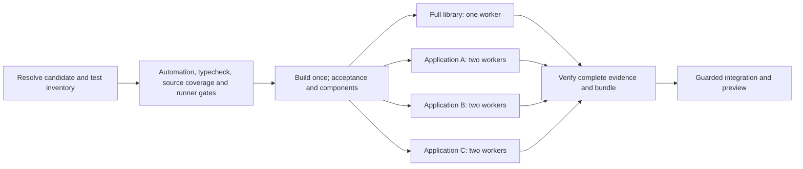

# CI test orchestration: latency, parallel execution and result reuse

**Research synthesis, 2026-10-22.** Use this record to plan faster integration
and release validation for Operations. It covers scheduling, sharding,
failure recovery, evidence reuse and measurement. Test semantics and test
authoring are outside its scope. Recommendations below are **proposed**;
this research did not change workflows or run a benchmark.

The main opportunity is to divide the browser suite into independently
retryable jobs, with a strict combined evidence gate. Two completed browser
runs each took about 66 minutes. Our current job and proof boundaries make
a small correction pay that cost again. Reusing results across different
commits is possible in principle, but needs stronger dependency boundaries
than the current browser harness provides.

The [CI ADR](adr/continuous-integration.md),
[test suite ADR](adr/test-suite-reports.md) and
[automation guide](../.github/workflows/README.md) govern current behavior
and control on disagreement. Code was audited at
[`1ac76addb6ec54089e51cf06f531ce77c3955687`](https://github.com/superhero/operations.superduper.solutions/commit/1ac76addb6ec54089e51cf06f531ce77c3955687).
The historical timings below are from separate, identified release-validation
runs, rather than a benchmark of that exact develop revision.

## Where the time went

### Observed baseline

These figures come from completed GitHub Actions logs and Vitest JSON
reports already collected during release work. No new run or host inspection
was required.

| Completed run | Outcome relevant to the next attempt | Whole workflow elapsed | Browser JSON file span |
| --- | --- | --- | --- |
| [39771491657](https://github.com/superhero/operations.superduper.solutions/actions/runs/39771491657) | Source coverage gate failed | 5m 08s | Browser suite not reached |
| [39773845277](https://github.com/superhero/operations.superduper.solutions/actions/runs/39773845277) | 576 browser cases passed; 11 failed | 75m 05s | 66m 30s |
| [39787609451](https://github.com/superhero/operations.superduper.solutions/actions/runs/39787609451) | 586 browser cases passed; 1 failed | 73m 52s | 65m 38s |

Those three workflow durations total **2h 34m 05s**, excluding gaps spent
investigating and correcting failures. The wait was repeated validation,
not just observation of one long run. The corrections were source coverage
boundaries, stale UI expectations, and then an intermittent readiness issue
in a test. Their implementation is outside this record; the orchestration
lesson is how expensive each subsequent attempt became.

The later run reported:

| Work | Cases | Reported test duration |
| --- | ---: | ---: |
| Automation contracts, in a separate job | 1,072 | 104.88s |
| Source tests with scoped coverage | 1,036 | 153.40s |
| Gherkin runner contracts | 23 | 14.99s |
| Acceptance | 27 | 1.19s |
| Application browser tests | 587 | 3,939.03s |
| Browser components | 7 | 6.88s |

The build took about 12 seconds. The browser step, including its wrapper and
component execution, took 66m 16s; this differs from the browser-only JSON
span. Parallel job times must not be added to estimate workflow elapsed time.
The combined diagnostic inventory contained 2,752 cases. Vitest's
`Duration (... tests 100%)` annotation describes time allocation, not the
pass rate; this run still had one failed case.
[Vitest timing guidance][vitest-performance]

Both browser reports contain 59 feature files and 587 cases. Four full-library
files ran serially first, taking 13m 51s and 14m 09s. The remaining 55 files
then used two workers for 52m 36s and 51m 26s. The largest application file,
`legacy-smoke.feature`, took about 13m 39s in the later run. Equal file counts
would therefore produce uneven workloads. The single failed case in that
run took 18.841 seconds; that does **not** mean a trustworthy retry can already
be reduced to 19 seconds.

The container logged a 5 GiB memory cap, 5,241 `memory.events` cap hits and no
OOM kills in the later run. **Supported fact:** memory pressure occurred.
**Unresolved:** how much it affected latency or failures; CPU utilization and
a controlled alternative configuration were not measured. Do not diagnose
all slow tests as memory starvation from this signal alone.

### Evidence and calculation limits

Browser spans are `max(testResults.endTime) - min(testResults.startTime)`.
Library membership comes from
[`browser-projects.mjs`](../tests/gherkin/browser-projects.mjs). Case counts
and durations come from each report's assertion results. Durations of files
running together overlap; their sum describes scheduled work, not CPU time.
These are two failure-bearing samples, not a stable p50/p95 baseline.

The exact browser JSON SHA-256 digests are retained so later analysis can
identify the same inputs even if temporary local copies are removed:

| Run | `vitest-browser-chromium.json` SHA-256 |
| --- | --- |
| 39773845277 | `446ee7aa2ee2c615a6e73eb23e745f380a59999bfcf7778b24b1e04a447c2402` |
| 39787609451 | `f4efb5c067832de1b7c8da91d09de38d4cd18851dc126e17889b96b67471df56` |

GitHub log and artifact retention can expire. The compact observations and
method above remain useful, but the digests alone cannot reconstruct reports
or independently prove their contents.

## What currently amplifies the cost

These are findings from the audited implementation, followed by their
implications. Existing completeness checks are valuable and should remain.

| Current implementation | Implication |
| --- | --- |
| [Release CI](../.github/workflows/ci-release.yml) groups source coverage, runner contracts, build, acceptance, browser tests, components and report production in one `Test and Build` job. | GitHub cannot retry only its failed browser step. Earlier successful work in that job repeats. |
| The browser wrapper runs on one Docker host with two CPUs, 5 GiB and at most two application workers. Full-library tests precede application tests on that host. | Most of the latency sits behind one host and a serial project boundary. More processes on that same host need a measured resource budget. |
| [The runner](../tests/gherkin/run.mjs) marks `--shard`, feature/tag selectors and name filters as partial. A complete proof requires the entire expected case inventory. | Adding a shard matrix alone would fail certification. Planned shards need their own validated contract and an aggregate proof. |
| [Report verification](../.github/scripts/test-results.mjs) and [validation manifests](../.github/scripts/validation-artifacts.mjs) require matching HEAD, configuration, toolchain, run ID and run attempt. | Passing results from attempt 1 cannot simply be mixed with a retry from attempt 2. |
| [Validation lookup](../.github/scripts/find-validation.mjs) reuses a complete successful validation with matching tracked inputs; only canonical root `CHANGELOG.md` is excluded from that input fingerprint. | Passing parts of a failed run, or a test-only change on a new commit, do not qualify for existing reuse. |
| All browser step-definition modules are dynamically registered by [shared setup](../tests/gherkin/setup.browser.mjs); browser tests drive a separately built application. | Filename pairing and Vitest's ordinary source import graph do not prove that another browser feature is unaffected. |

**Inference:** the largest avoidable repeat cost is the granularity of jobs
and evidence, rather than the 12-second build. This does not establish that
the individual browser tests are already efficient.

We already have useful optimizations: focused development checks, a Markdown
documentation route, complete-validation reuse, browser contexts isolated per
case, shared worker-lifetime browsers, and `isolate: false` in the Gherkin
Vitest configuration. Recommending these as new changes would miss the actual
gap. The current global `integration-ci` lock also spans validation and
integration work. It can hold other candidates behind a long run; queue wait
was not measured here, so it is not assigned a share of the observed latency.

## Distinguish retry, resume and reuse

GitHub supports rerunning failed or selected **jobs** on the original
`GITHUB_SHA` and `GITHUB_REF`. It does not resume an arbitrary failed step
inside a job. A code or test correction creates a new commit and requires a
new validation decision. These platform capabilities do not override our
stricter report contract. [GitHub rerun documentation][github-reruns]

| Situation | Current behavior | Proposed trustworthy behavior |
| --- | --- | --- |
| Same commit; one browser shard fails because of transient infrastructure | No independently retryable shard exists. | Retry that job; retain successful sibling proofs, preserving every original attempt identity. |
| Same commit; a failed case is rerun manually and passes | Filtered output is diagnostic. | Keep diagnostic unless an explicit retry policy and aggregator account for the original failure and the entire planned inventory. |
| New commit adds a feature using unchanged shared steps and runtime | Full validation reuse is invalidated. | After dependency boundaries are established, rerun the new/changed feature's shard and verify that reused sibling inputs are identical. |
| New commit changes a shared step, fixture, hook, runner, dependency or browser configuration | Full validation reuse is invalidated. | Invalidate every dependent partition; default to the entire affected profile when dependencies are uncertain. |
| New commit changes application runtime, bundled schemas, assets or build inputs | Full validation reuse is invalidated. | Rerun all required browser partitions unless a separately proven runtime dependency boundary exists. Initially assume all are affected. |
| Canonical root changelog changes after a successful complete validation | Existing narrowly checked reuse may apply. | Preserve that route and the original provenance. |
| Documentation-only PR on the documented docs route | Specialized Markdown validation applies. | Preserve it; it is not a replacement for release validation of changed application inputs. |

**Recommendation:** implement same-commit job/shard recovery before building
a cross-commit result cache. This addresses expensive transient retries with
a much smaller invalidation problem. It will not by itself avoid reruns after
fixing a test on a new commit.

## Proposed browser partitioning

A **worker** is a concurrent process on one host. A **shard** is an assigned
subset run by a separate test invocation, which can use another CI host.
They consume different resources. Our `--matrix` option currently runs
Chromium, Firefox and WebKit serially; it is not a distribution mechanism.
Do not multiply required browser engines accidentally while adding shards.

Vitest provides file sharding, blob reports and `--merge-reports`. Its
documented shard unit is the **test file**, not each case. Native Playwright
Test also supports sharding and optional case-level parallelism, but our
application suite is QuickPickle on Vitest with Playwright as a driver.
`fullyParallel`, `playwright test --last-failed` and native Playwright report
merging are not drop-in replacements for that runner.
[Vitest sharding][vitest-performance], [Playwright sharding][playwright-sharding]

Start with this **pilot layout**, subject to available CI capacity:

| Browser job | Assignment | Local worker budget |
| --- | --- | --- |
| Full library | Existing four full-library features | One worker; preserve serial execution |
| Application A | Duration-balanced feature subset | Two workers |
| Application B | Duration-balanced feature subset | Two workers |
| Application C | Duration-balanced feature subset | Two workers |

Each job needs its own container, output directory and resource limits. This
requires four concurrent runner allocations, each with sufficient headroom
for its container. Preserve the full-library isolation rule by giving that
job a separate host.
Playwright's CI guidance also favors spreading work across machines over
overcommitting local workers. [Playwright CI][playwright-ci]

Use a deterministic, versioned **feature assignment plan**. Balance using
recent file durations, preserve stable assignments for retries, and give
new files a conservative duration estimate. Default equal-count Vitest
shards are a useful mechanism but insufficient balancing for this corpus.
A custom sequencer or explicit partition lists must stay compatible with
QuickPickle discovery and expected-case accounting.
Rebalance deliberately when measured imbalance justifies it; constantly
moving files between shards would reduce opportunities to reuse results.

**Forecast, not a benchmark:** the later application run contains 6,165 seconds
of summed file durations. Dividing that work over six application worker
lanes gives an idealized 17.1-minute floor. Sorting the historical files by
duration and assigning each to the least-loaded of six lanes gives a maximum
lane load of 17.2 minutes; the earlier sample gives 17.5 minutes. The library
job would overlap at about 14 minutes. This model assumes unchanged file
durations, suitable scheduling, independent resources and all four hosts
available together. It excludes queue, startup, transfer and aggregation
overhead. It is not a measured multi-host execution.

A **20–30 minute browser gate** is therefore a reasonable pilot target,
not a commitment. The 13.6-minute largest application feature limits gains
from file sharding. More hosts eventually need finer partitioning or shorter
files to help; do not introduce case-level scheduling complexity first.
If only two hosts are available, queued waves will change the estimate.
Wall time, total runner-minutes and provisioned capacity must all be measured;
neither a fourfold speedup nor fourfold cost follows automatically.

## Proposed pipeline flow

Keep the first version simple: cheap gates first, build once, browser jobs in
parallel, one verifier before merge/deployment. The diagram describes future
responsibilities, not today's workflow.

Tiny acceptance/component profiles need not each pay for a fresh runner and
dependency installation. Keep their **evidence** separate while placing them
where setup is shared. Source coverage is roughly 2.5 minutes: rerunning that
complete scoped profile is a better initial trade than incremental coverage
merging. Preserve all six required profiles and the existing 100% statement,
branch, function and line thresholds within `coverage.config.json`.

For the browser matrix, use `fail-fast: false` so one failure does not cancel
other useful shard results. Limit simultaneous jobs with `max-parallel`
according to actual capacity. Do not use `continue-on-error` to turn required
failures into success. Generate combined diagnostics even after a shard
failure, but permit certification only when every required result passes.
This differs from running cheap gates first: one avoids wasted expensive
work; the other avoids throwing away useful work already running.
[GitHub matrix controls][github-matrix]

Keep the existing integration lock initially. Later, if measured queue wait
dominates, consider concurrent validation of immutable candidates with a
shorter protected merge/publication section. That needs a separate design:
changed target ancestry must trigger validation of the new candidate, and
expected-head/base guards must remain. Removing serialization without this
would trade latency for stale validation.

## The proof contract must evolve with the scheduler

A merged HTML report is not sufficient evidence that every required case ran.
Sharding needs an aggregate contract, not merely a more permissive
`complete: true` flag. The implementation should prove:

1. **Exact inventory:** a trusted, versioned plan enumerates required profiles,
   browser engines, feature files, example rows and assigned case identities.
   Every required case appears once in the selected successful results; no
   missing, duplicate, unexpected, skipped or unaccounted cases pass the gate.
2. **Bound inputs:** every selected result matches the candidate application
   bundle, required fixtures/assets, partition contents, shared harness,
   installed toolchain and execution configuration. Record browser image
   identity and the assignment-plan digest as well.
   Retain a separate partition-input digest. If a global plan changes, reuse
   requires an explicit check that the selected old partition remains
   identical under the new plan; its original plan identity stays unchanged.
3. **Original provenance:** retain workflow/job/run/attempt identities, tested
   commit, timestamps, shard identity, exit status, and hashes of raw results,
   blobs and relevant attachments. Never relabel an old result as a new run.
   Accept only approved workflow producers; a matching hash does not establish
   that an artifact came from a trusted execution.
4. **Complete execution:** validate cases, steps and hooks using the existing
   Gherkin rules. Planned shard selection must be distinct from an arbitrary
   diagnostic name/tag/feature filter.
5. **Explicit attempt selection:** if shard B passes on attempt 2 while A and
   C passed on attempt 1, the manifest records that exact selection and the
   superseded failure. A later failed attempt must not be silently replaced
   by an older green one. Retry count and flaky outcomes remain visible.
6. **Independent gates:** all required profiles and full scoped source coverage
   still pass. Only then produce the final validation manifest and promote
   the exact tested bundle through existing guarded integration.

Our fixed paths such as `blobs/browser-chromium.json` and
`executions/browser-chromium.json` would collide when flattened after parallel
execution. Names and artifact boundaries must include project/engine, shard
and attempt. GitHub's artifact action requires distinct artifact names across
matrix jobs; overwriting deletes the old artifact and creates a new identity.
Use immutable artifact IDs/digests when retaining evidence. A dependency cache
hit is never a successful test result. [Artifact action contract][upload-artifact]

This requires coordinated changes in the runner/configuration,
`test-results.mjs`, `validation-artifacts.mjs`, `find-validation.mjs`, both
release and main workflows, and their automation contracts. Changing only the
workflow would leave same-attempt and complete-profile checks rejecting the
new layout. Required checks must also include the final aggregate gate;
all shard jobs finishing is not enough.

Bound retries and preserve first-failure evidence and flaky outcomes. Keep
time for cleanup and artifact upload before the enclosing job deadline; a
hard timeout that destroys the only report makes recovery harder. Retrying
until a run happens to pass is not a validation policy.

## When can a new test avoid rerunning existing tests?

Reuse requires identical relevant inputs for unchanged results and complete
coverage of the new inventory. Adding a test does not logically
invalidate every previous test, but our present whole-tree fingerprint has no
narrower certified reuse boundary.

Start future reuse at **feature file or shard** granularity. Case identities
currently include source/example line numbers; inserting rows can shift
identities without changing behavior. Per-case caching adds identity migration,
shared setup and coverage problems before the simpler approach is proven.

For a reusable partition, account for at least:

- The exact application build and its runtime assets, including bundled data.
- Its features, example rows, tags, step definitions, fixtures and attachments.
- Global setup/teardown, dynamically registered steps, QuickPickle integration,
  test selection rules and the assignment plan.
- Lockfile, Node/package versions, browser binary/image, OS-relevant execution
  configuration and any external inputs capable of changing the result.

Vitest's `--changed`/`related` selection can help fast feedback. Its current
documentation also describes experimental runtime dependency recording, which
improves on a static import graph. Neither automatically observes application
code executed in a separate browser from our built `dist`, or proves the
effects of shared dynamic registration. Treat selection as diagnostic until
its completeness is demonstrated for this integration; verify experimental
option compatibility against the pinned version before adopting it.
[Vitest CLI and dependency selection][vitest-cli]

**Recommendation:** define conservative invalidation rules and fall back to the
full affected profile on an unknown dependency, missing artifact, changed
configuration or incompatible proof version. Shared step changes initially
invalidate the browser profile. Preserve original tested commits in reused
proofs and let a new manifest explain equivalence; do not rewrite history to
claim the new commit executed an old result. Cross-commit reuse needs an ADR
change and contract tests before it can certify a release.

UI expectation fixes often change step-definition modules. Our historical
test-only corrections therefore are not automatically eligible for narrow
feature reuse. The shared registration boundary needs review first; sharding
still shortens each full validation while that limitation remains.

## What the external patterns do and do not establish

### Public skills

Two relevant public skills were reviewed as inert text at immutable revision
`0874a27b17a22e2b7c2e2bcd725768e0803cad06` of `wshobson/agents`:

| Skill | Useful principle | Applicability and limits |
| --- | --- | --- |
| [GitHub Actions templates][skill-actions] | Explicit job dependencies, matrices, reusable workflows and dependency caching. | Author templates, not performance evidence. Examples include Node 18/20 and deployment/scanner integrations; do not copy their versions, permissions or services into this project. |
| [Deployment pipeline design][skill-pipelines], including its two references | Cheap gates before expensive work; independent jobs in parallel; build once and promote the same artifact. | Broader deployment guidance. Its generic skip-test input and cloud/Kubernetes examples do not define our release gate. |

Both skills share one publisher/lineage and do not constitute independent
corroboration. The root [MIT license][skill-license] names Seth Hobson;
no overriding license appeared in the inspected parent paths or selected
subtrees. The actions subtree contains only `SKILL.md`; the pipeline subtree
contains `SKILL.md`, `references/details.md` and
`references/advanced-strategies.md`, plus the reference directory entry. All
four Markdown files were read; no executable or binary entries were present.
Tree IDs are `45cfc1b2dc87bb54b19c263e4e0c0461e038e770` and
`36ca0e303f904fba79c64859c82d9a969e53ae4b`, respectively.

Their example instructions install dependencies, use secrets, write artifacts,
push images, deploy infrastructure and send notifications. None were executed
or installed. Related GitLab/secrets skills were outside the selected scope.
The retained material is independently paraphrased; no templates were adopted.

### Practitioner experience and counterevidence

**Source assertion:** Bjorn Krols describes a four-shard GitHub Actions proof
of concept with isolated PostgreSQL services and combined blob reports
(Rush Labs, 2026-05-17). This supports a concrete orchestration pattern, not a
measured speedup for Operations. It is published by a consultancy promoting
its services. Its browser-cache recommendation differs from Playwright's
general advice that restoration can cost as much as download. We already use
a browser-containing Docker image, so that cache recipe is not a demonstrated
priority here. [Rush Labs account][rush], [Playwright CI][playwright-ci]

**Source assertion:** Sri Harsha, reviewed by Srinivasan Sekar, reports worker
scaling for a uniform 24-test workload on an eight-core Apple M3 with 16 GB,
macOS 26.5 and Playwright 1.62.1 (TestMu AI, 2026-08-06). Two cold samples per
worker count show diminishing returns. Crucially, the four shards were run
sequentially on one machine and their concurrent elapsed time was inferred.
It is a small synthetic workload from a testing vendor, not an independent
multi-host production benchmark. It reinforces measuring worker capacity and
distinguishing elapsed time from compute consumption; its seconds and speedup
ratios do not transfer to our application. [TestMu AI account][testmu]

The sources agree on independent jobs and report aggregation, but their
granularity and environments differ. Native Playwright case parallelism,
generic skill templates and our Gherkin/Vitest file scheduling are not the
same implementation. No external headline reduction is used in our forecast.

## Prioritized implementation and measurement plan

| Priority | Proposed work | Evidence required before relying on it |
| --- | --- | --- |
| 1 | Introduce a versioned shard plan, unique artifacts and strict aggregation together; split browser jobs from cheap profiles; pilot library + three application jobs. | Same required inventory as the full run; rejected missing/duplicate/wrong-input proofs; measured wall time, resource use and capacity. |
| 2 | Support retry of failed jobs while retaining verified successful sibling attempts on the same commit. | An intentionally failed shard can recover without rerunning green siblings; mixed attempts retain their true provenance; unresolved failures block certification. |
| 3 | Add earlier source/runner coverage and a bounded affected-browser check before release integration. | Measure failures caught and latency added. This revisits the current deliberate develop test policy; focused output remains diagnostic. |
| 4 | Permit narrowly defined test-only reuse across commits. | A reviewed dependency/invalidation model, versioned cache keys, proof expiry/retention rules and negative contracts for every shared-input change. |
| 5 | Optimize tracing, setup, large files or integration serialization only where measurement points. | Controlled representative comparisons and preserved failure diagnostics, coverage, isolation and merge safety. |

Do not start by raising timeouts, weakening coverage, assuming every changed
test is independent, adding many local workers, or building a per-case green
cache. Those changes either mask symptoms or introduce proof complexity before
the dominant scheduling issue is addressed.

The current browser support starts tracing with screenshots/snapshots/sources
for ordinary cases and discards passing traces afterward. That still pays
capture overhead. Playwright warns that tracing every test is expensive and
recommends retry-based tracing for its native runner. **Hypothesis:** a tailored
capture policy may reduce our runtime. Measure a representative cohort before
changing it, and preserve evidence for first-attempt failures; native runner
configuration does not configure our manual tracing automatically.
[Playwright tracing guidance][playwright-tracing]

Track these separately for each candidate and retry:

- Queue delay, preparation, dependency installation, build, each profile/shard,
  artifact transfer, aggregation and guarded integration elapsed times.
- Expected/executed/reused case counts, selected proof identities, retry count,
  first-failure outcomes and invalidation reasons.
- Worker count, CPU quota, peak memory/cap events, host availability, slowest
  feature and shard imbalance.
- End-to-end time to trustworthy green, p50/p95 over a stated observation
  window, total runner-minutes and cost. Two historical runs cannot establish
  those distributions.

Use the existing full run as a temporary comparison while proving the new
aggregator; do not permanently pay for both. A pilot succeeds when inventory
and failure handling remain exact and measured feedback time improves within
an agreed resource budget. No hosts were provisioned or used for this research.

## Provenance, research coverage and maintenance

**Lifecycle:** create this canonical research record and link it from the
documentation index. It does not supersede an ADR. Impact was not assessed
beyond the known CI, runner and report contracts linked here.

**Discovery scope:** normal-depth, bounded research. Five discovery queries
were used; 12 external records were selected: eight first-party technical
documentation pages, two public skills from one publisher, and two practitioner
articles. Official pages were reached through canonical documentation URLs;
skills through GitHub-native APIs and pinned source trees. Practitioner
searches used generic public technology terms, without project data.

| Discovery query | Bound and observed coverage |
| --- | --- |
| GitHub code: `filename:SKILL.md "github-actions" "matrix" is:public` | Page 1, limit 10; total 0; `incomplete_results: false`. A negative result for this query only. |
| GitHub code: `repo:github/awesome-copilot filename:SKILL.md "CI" "pipeline"` | Page 1, limit 5 of 66; `incomplete_results: false`. Returned brag-sheet, dotnet-upgrade, geofeed-tuner, msstore-cli and gdpr-compliant; none selected. Remaining pages not screened. |
| Web: `Playwright sharding GitHub Actions engineering "we" "minutes"` | Broad discovery; combined output with the next query was truncated. |
| Web: `Vitest CI sharding engineering "we" tests performance` | Broad discovery; complete result count and coverage unavailable. |
| Web: `Playwright sharding CI engineering experience faster tests minutes blog -site:reddit.com -site:youtube.com -site:medium.com` | Nine returned leads; selected the two primary practitioner accounts discussed above. No exhaustive result total/pagination supplied. |

Direct inspection of the known `wshobson/agents` CI plugin found four skill
directories; the two selected subtree listings were complete and untruncated.
Discovery stopped once local bottlenecks, supported APIs, compatibility limits
and the major alternatives were adequately covered. The envelope capped work
at six queries, 32 screened leads, 24 selected sources and 90 active research
minutes. Broad-output truncation prevents a reliable total of screened leads;
coverage is **partial**, not an exhaustive skills/blog ranking. Unread search
results do not support claims in this record.

**Freshness:** sources were retrieved and their applicable identity/version
checked on 2026-10-22, within the limits stated here. Public documentation and
blog pages are mutable; exact page revisions were not pinned. The repository
locks Node 26.7.0, npm 11.19.0, Svelte 5.57.1, Vite 8.3.2, Vitest 5.0.5 and
Playwright 1.63.0, with vendored QuickPickle. Live Playwright documentation
already contains newer image examples. Resolve concrete options against the
lockfile and vendored integration before implementation; no upgrade is implied.
Public skills are pinned to the full revision and trees above, not a branch.

**Review triggers:** update this record when runner/profile boundaries,
QuickPickle, test identities, report/provenance schemas, CI concurrency,
resource capacity or relevant tool versions change. Replace forecasts with
pilot observations, and date the sample/candidate/configuration used. Amend
the owning ADRs and automation guide if recommendations become policy.

**Remaining questions:** available concurrent runner capacity and cost;
controlled memory/tracing impact; actual multi-host scheduling overhead;
safe browser dependency boundaries for test-only changes; and artifact
retention sufficient for recovery. None prevents using this record to design
a pilot; they prevent promising its runtime or enabling cross-commit reuse now.

[vitest-performance]: https://vitest.dev/guide/improving-performance#sharding
[vitest-cli]: https://vitest.dev/guide/cli
[playwright-sharding]: https://playwright.dev/docs/test-sharding
[playwright-ci]: https://playwright.dev/docs/ci
[playwright-tracing]: https://playwright.dev/docs/best-practices#debugging-on-ci
[github-reruns]: https://docs.github.com/en/actions/how-tos/manage-workflow-runs/re-run-workflows-and-jobs
[github-matrix]: https://docs.github.com/en/actions/how-tos/write-workflows/choose-what-workflows-do/run-job-variations
[upload-artifact]: https://github.com/actions/upload-artifact#not-uploading-to-the-same-artifact
[skill-actions]: https://github.com/wshobson/agents/blob/0874a27b17a22e2b7c2e2bcd725768e0803cad06/plugins/cicd-automation/skills/github-actions-templates/SKILL.md
[skill-pipelines]: https://github.com/wshobson/agents/blob/0874a27b17a22e2b7c2e2bcd725768e0803cad06/plugins/cicd-automation/skills/deployment-pipeline-design/SKILL.md
[skill-license]: https://github.com/wshobson/agents/blob/0874a27b17a22e2b7c2e2bcd725768e0803cad06/LICENSE
[rush]: https://rush.be/insights/sharding-playwright-across-ci-runners
[testmu]: https://www.testmuai.com/learning-hub/playwright-parallel-testing/
