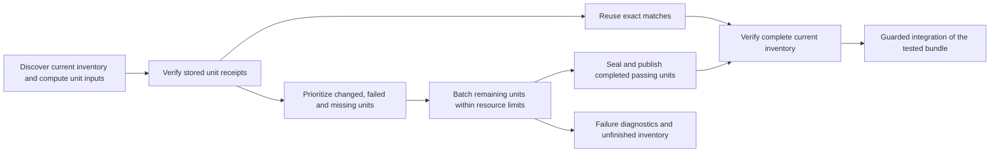

# CI test orchestration: avoid repeated work and reduce execution cost

The historical audit and recommendations below describe the pre-implementation
baseline. The resulting implementation and recovery policy are maintained in
[resumable CI validation](ci-incremental-validation.md); its local verification
is recorded [separately](ci-incremental-validation-checks.md). Historical timings
here are not measurements of that implementation.

**Research synthesis, revised 2026-10-22.** Use this record to design faster
test integration for Operations: incremental validation, partial reruns,
execution overhead, checkpointing and parallel scheduling. Test semantics and
test authoring are outside scope. Existing cases were used for a small local
measurement; no versioned test, application or CI implementation changed.

The revised priority is **reuse unchanged test results, reduce execution cost,
then distribute the remaining work**. This supersedes the initial shard-first
recommendation. Four workers doing the same unnecessary work would shorten
the wait while leaving the main repeat-cost problem intact.

Three concrete findings change the plan:

- The last browser correction changed a step module associated with **one
  feature, 9 of 587 cases**. Its historical file cost was about **119 seconds**.
  A future verified file cache could retain the other 578 cases. Our current
  runner cannot certify that reuse yet.
- Helper imports make the apparent boundary misleading: `workspace.steps.mjs`
  participates in **50 feature dependency chains**, although only 23 features
  directly select its step definitions. Splitting shared helpers from step
  registration is part of making useful cache boundaries.
- A controlled comparison on an existing keyboard scenario reduced median
  case time from **19.71s to 16.42s** by reducing trace capture. All original
  assertions passed. This establishes a cost for that cohort, not a 17% saving
  for the entire suite.

The [CI ADR](adr/continuous-integration.md),
[test suite ADR](adr/test-suite-reports.md) and
[automation guide](../.github/workflows/README.md) govern current behavior and
control on disagreement. This is a planning record, not a change to release
policy. The deeper audit and experiment used
[`12f96beb4ab5b55b6734a4b229c6222b9b584ebe`](https://github.com/superhero/operations.superduper.solutions/commit/12f96beb4ab5b55b6734a4b229c6222b9b584ebe);
the application/test implementation is unchanged from `1ac76ad` at that point.

## What is actually expensive?

### Repeated validation and per-case preparation

The two completed runs below each executed 587 browser cases in 59 features.
They provide historical failure-bearing observations, not a stable benchmark.

| Run | Browser outcome | Whole workflow | Browser JSON span |
| --- | --- | --- | --- |
| [39773845277](https://github.com/superhero/operations.superduper.solutions/actions/runs/39773845277) | 576 passed, 11 failed | 75m 05s | 66m 30s |
| [39787609451](https://github.com/superhero/operations.superduper.solutions/actions/runs/39787609451) | 586 passed, 1 failed | 73m 52s | 65m 38s |

Together with the earlier [5m 08s source-coverage failure](https://github.com/superhero/operations.superduper.solutions/actions/runs/39771491657),
these workflow durations total **2h 34m 05s**, excluding investigation gaps.
Repeated work, rather than observation of one long run, explains that cost.

The later run's source coverage took 153.40s; runner contracts 14.99s;
acceptance 1.19s; components 6.88s; and the build about 12s. Automation took
104.88s in a separate job. Browser execution dominated at 3,939.03s. Parallel
job durations must not be summed to estimate elapsed workflow time.

The saved JSON also contains Gherkin step timings. For each case, subtracting
the sum of `meta.gherkin.steps[].duration` from the case duration exposes time
outside those steps:

| Run | Accumulated case seconds | Accumulated step seconds | Outside-step seconds |
| --- | ---: | ---: | ---: |
| 39773845277 | 7,134.647 | 5,182.995 | 1,951.652 |
| 39787609451 | 7,013.696 | 5,074.347 | 1,939.349 |

About **28% of accumulated case time** sits outside Gherkin steps. These
durations overlap across workers; 1,939 seconds is not an additional 32
minutes of wall time or a CPU measurement. It includes World/hooks, context
creation, application readiness, cleanup and bookkeeping. It is an attribution
gap, not proof that all of it is removable.

The later run's initial-context groups make that gap more specific:

| Initial context in browser support | Cases | Median outside-step seconds |
| --- | ---: | ---: |
| UI with example catalogs | 454 | 3.749 |
| UI with full production defaults | 31 | 3.622 |
| Other fixture page | 65 | 0.428 |
| Legacy initial blank page | 37 | 0.343 |

These groups describe the initial hook, not the whole scenario. Legacy cases
subsequently open their own UI/development contexts. Starting on a fixture
page does not establish independence from the application bundle. Likewise,
the four-file full-library resource project contains 43 cases, a different
classification from the 31 full-default startup contexts above.

**Implication:** instrument preparation and teardown separately before trying
to optimize them. Reusing a mutable page across tests would change isolation.
The existing adapter already retains the browser for its worker lifetime and
creates a fresh context per case; per-feature browser relaunch was ruled out
as the current cause. See [browser support](../tests/browser/support.mjs),
[compatibility adapter](../tests/gherkin/cucumber-compat.mjs) and
[worker fixture](../tests/gherkin/worker-test.mjs).

### Measured capture overhead

Three paired runs exercised the existing scenario **Custom shortcuts persist
and leave text editing alone**. Only diagnostic capture changed:

- Full: screenshots, DOM snapshots and sources enabled.
- Minimal: those three options disabled; tracing and network/action metadata
  retained. Network isolation, application build and assertions were unchanged.

The existing low-overhead implementation is normally limited to profiling
tags. An ignored native-loader overlay broadened that switch only inside
this experiment, allowing the ordinary scenario to run unchanged. No source
file was edited. All six executions passed every original Gherkin step and
assertion; their proofs remained `filtered: true`, `complete: false`.

| Execution order | Capture | Case seconds | Step seconds | Outside-step seconds | Invocation seconds |
| ---: | --- | ---: | ---: | ---: | ---: |
| 1 | Full | 19.895 | 15.919 | 3.976 | 24.534 |
| 2 | Minimal | 16.417 | 13.001 | 3.416 | 21.338 |
| 3 | Minimal | 16.940 | 13.585 | 3.355 | 21.401 |
| 4 | Full | 19.529 | 15.774 | 3.755 | 24.068 |
| 5 | Full | 19.711 | 16.042 | 3.669 | 24.049 |
| 6 | Minimal | 16.195 | 12.712 | 3.483 | 20.591 |

Case medians changed **19.711 → 16.417s**, a **3.294s / 16.7%** reduction.
All three pairs improved. Invocation medians changed **24.068 → 21.338s**,
11.3%; container CPU per invocation changed **21.429 → 17.647 CPU seconds**,
17.6%. This is reduced work as well as reduced elapsed time in this cohort.

Outside-step medians changed only **3.755 → 3.416s**. Capture therefore does
not explain the entire preparation/cleanup budget. The measured gain is
primarily inside step execution, where Playwright captures browser actions.
Medians are calculated independently; do not add or subtract them as if they
were one sample.

Conditions: Node 26.7.0, Playwright 1.63.0, Chrome for Testing 153.0.8010.12;
one worker; one Docker CPU, 3 GiB RAM, no swap, 512 processes and a 1,800 MiB
Node heap. Sources were read-only, output isolated and network external to the
container disabled. Peak container memory was 1,543,704,576 bytes with no
memory-limit or OOM events; CPU-quota throttling occurred. Existing host
services remained running. This differs from CI's
two CPUs, 5 GiB and 512 MiB Node heap, so it cannot predict whole-suite savings.
No tail percentile or statistically established production effect is claimed.

**Recommendation:** evaluate a central capture policy: lighter ordinary runs,
full capture for diagnostic/trace-contract cases and targeted investigation.
Keep original failure screenshots, errors and step evidence. A retry cannot
retroactively recover the first failure's DOM timeline, so this is an explicit
diagnostic tradeoff. Legacy and report fixtures create additional contexts
with their own capture settings; changing the main hook alone will not change
all of them. Playwright also warns about recording full traces on every test.
[Playwright tracing guidance][pw-tracing]

Prepared immutable IndexedDB state is a separate **hypothesis** for the
remaining setup cost. We already seed storage through
[`exampleCatalogState`](../tests/browser/catalog-state.fixture.mjs), but that
stores installation markers rather than a complete ready repository. Measure
context creation, seeding, navigation/readiness and close/trace finalization
before testing a versioned prepared snapshot. The context API supports
IndexedDB snapshots; real startup, migration, storage and motion checks must
retain their intended starting state. No snapshot saving is established here.
[BrowserContext storage state][pw-storage]

## The dependency problem behind unnecessary reruns

### The last fix had a small logical scope

[`1ac76ad`](https://github.com/superhero/operations.superduper.solutions/commit/1ac76addb6ec54089e51cf06f531ce77c3955687)
changed `keybindings.steps.mjs` and generated changelog material. The application
and feature files were unchanged. Its browser correction added readiness
waits before the existing Redo action.

A collection-only probe resolved every recorded step in all 59 features,
recording definition owners, applicable hooks and observed native imports:

| Changed module | Features directly selecting its steps | Features in its import dependency closure |
| --- | ---: | ---: |
| `keybindings.steps.mjs` | 1 | 1 |
| `workspace.steps.mjs` | 23 | 50 |
| `workflow-defaults.steps.mjs` | 1 | 6 |

The keybindings feature contains **9 cases**, about **119.165 accumulated
case seconds** in the previous run. **Counterfactual:** once scoped execution
and result proofs are implemented, rerunning that file could retain the
other **578 cases, 98.5% of the inventory**. That is approximately two minutes
of historical browser-file work instead of another 66-minute browser phase,
plus the remaining pipeline/setup cost. It is not an achieved cache hit or a
benchmark of the corrected nine-case file.

The broader UI correction, `ac5cba3`, touched ten browser files, including
`workspace.steps.mjs`. The observed graph already selects 50 features/493
cases before accounting for two dynamically imported legacy fixtures. A
blanket “test-only changes are cheap” rule would be wrong.

### Helper imports expand invalidation

[`workspace.steps.mjs`](../tests/browser/workspace.steps.mjs) exports helpers
such as `workflow`, `field`, `setMode` and `readExport` alongside step
registrations. Other step modules import these helpers from it. The same
pattern occurs with exported defaults/storage helpers in
[`workflow-defaults.steps.mjs`](../tests/browser/workflow-defaults.steps.mjs).

**Recommendation:** move reusable helpers into ordinary fixture/helper modules;
keep step registrations in the step modules. Changes to shared helpers should
still invalidate their dependents. An assertion change in an unrelated
registration should not invalidate every helper importer. For workspace, 27
of the 50 associations arise beyond direct step selection; this identifies
coupling to investigate, not a guaranteed count of safely skippable features.

The current [browser setup](../tests/gherkin/setup.browser.mjs) imports every
step module, and the native loader caches imports across a worker. The
collection graph is therefore **not a certified impact graph**. It cannot
exclude arbitrary top-level effects, later dynamic imports, fixture file
reads or application execution inside the browser. The two legacy fixture
changes above were absent from it. Do not turn this probe into a production
selector without closing those gaps.

## Cache results at a different granularity from CI jobs

A logical cache unit can be a complete feature file. A CI job can execute
several such units with bounded concurrency. This avoids both a monolithic
cache entry and 59 separate runner/dependency installations.

Three mechanisms must remain distinct:

| Mechanism | What it establishes |
| --- | --- |
| Exact-input result reuse | A required unit passed previously with equivalent declared execution inputs. The current aggregate still accounts for it. |
| Impact-based selection | A model estimates which tests may be affected. Static/coverage models can miss dependencies. |
| Deferring tests | Some tests run later or less often. This changes gate policy. |

The first mechanism is the initial target. A coverage-based selector or a
nightly full run does not, by itself, prove an exact-input cache safe.

### Start with two explicit levels of reuse

**Level 1: feature-only changes.** Keep the entire current shared step/hook/
fixture registry in each unit's inputs. If those inputs and the application
are unchanged, editing or adding a feature need only invalidate that feature.
Units that read other feature files or the global inventory must declare
those dependencies. This narrower path does not require pretending that step
modules are already independent. A new step module still invalidates shared
registry users at this level.

**Level 2: scoped step changes.** Give each feature an explicit import/fixture
manifest, covering selected definitions, applicable hooks, transitive helpers,
dynamic imports and data. Move helpers out of registration modules. Check
that every existing case resolves to the same definition before accepting the
new boundary. Unknown dependencies fall back to the whole affected profile.
This is the level needed for the keybindings-fix counterfactual.

The initial implementation can use a fresh Node invocation per feature,
several invocations per CI job. It gives the native registry and cleanup a
clear owner. A long-lived global registry that accumulates other features'
definitions undermines a narrow input manifest; `isolate: true` alone does
not establish isolation for our native external imports. A scoped reusable
registry is a later alternative requiring its own contracts.

Fresh invocations have a cost: the measured single-case invocations spent
roughly 4–5 seconds outside the case. A cold run with many invocations may
pay more startup work than today's warm worker. Measure that tradeoff rather
than claiming caching is free. Share dependency installation and immutable
fixture builds at the job level; keep each unit's mutable state isolated.

### Check whether the cache costs less than the work it avoids

Measure both cold and warm paths. A useful accounting model is:

```text
execution work = sum(case work + unit startup/cleanup for cache misses)
              + planning, key lookup, artifact transfer and verification
wall time     = queue + serial preparation + longest scheduled worker path
              + aggregate verification
```

**Illustration, not a benchmark:** if independent invocations added five
seconds per file, 59 cold files would add 295 process-seconds, before any
lookup/transfer cost. With two equally loaded workers that would be roughly
148 extra wall seconds without contention. That cost must appear in the cold
comparison. A high hit rate can still make the warm path much cheaper, while
poorly scoped keys or expensive blob downloads can erase the benefit.

The first pilot should therefore compare three workloads: a cold application
change, adding one feature using existing steps, and correcting one scoped
step module. Record artifact bytes and transfer/verification time as well as
fresh/reused case counts. Reject a design that saves reported test time merely
by moving substantial work into unmeasured setup. The nine-case example is a
warm-path goal; the 50-feature helper change is a necessary broad-invalidation
control. Do not add coverage-cache complexity to save a short source phase
before the browser-result reuse is useful.

### What belongs in a result key?

The key identifies behavior-affecting inputs, not the Git commit or workflow
attempt alone. A proposed model is:

```text
unitKey = hash(
  receipt schema and dependency-policy version,
  feature path and exact feature bytes,
  application artifact or required fixture-bundle hashes,
  declared step/hook/helper files and transitive inputs,
  fixture data and controlled starting state,
  installed toolchain, Node/browser/image/platform identity,
  behavior-affecting flags, configuration and clock policy
)
```

Keep producer commit, run, attempt, timestamps and artifact IDs in provenance.
They do not have to invalidate an otherwise identical unit. Likewise, adding
another feature or moving a unit to another execution batch should not change
its key unless that changes its execution inputs. The aggregate separately
records the current inventory and scheduling plan. Source-position IDs can
remain at file granularity: editing that file invalidates it without shifting
keys for other files.

Hash actual input contents and resolved tool/image identities. Include Git
metadata if a test reads it. Record flags that change what executes; arbitrary
debug loaders or the startup-only profiling flag cannot produce normal release
evidence. A unit dependent on uncontrolled time, external state or mutable
services needs controlled fixtures or must remain uncacheable. Make reuse age
and scope explicit; a single release-validation campaign is a narrower first
deployment than unlimited cross-branch reuse.

For UI units, initially treat the whole application artifact as an input.
For a genuinely standalone browser fixture, a later manifest can depend only
on its fixture bundle and harness. Audit child contexts and later navigation
before removing the application dependency. Browser-observed code is not
automatically represented by the Node/Vitest import graph.

This follows the task-input model used by [Nx][nx-inputs],
[Turborepo][turbo-cache] and [Bazel actions][bazel-cache]. Their mechanisms do
not supply the missing project dependency declarations for us.

## Resume completed work even when the workflow fails

The current [runner](../tests/gherkin/run.mjs) writes one profile report/proof;
feature/name/shard filters remain diagnostic. The
[verifier](../.github/scripts/test-results.mjs) and
[validation manifest](../.github/scripts/validation-artifacts.mjs) require
complete profiles from the same run attempt. Existing
[reuse lookup](../.github/scripts/find-validation.mjs) requires a successful
complete workflow and matching tracked inputs, except canonical root changelog
material. These are deliberate constraints, not native Vitest requirements.

The required change is **independent unit completion**, followed by aggregate
certification. A passing feature should not lose its value because a later
feature fails. It should also not be treated as green before its own hooks,
cleanup and report production have completed.



A unit receipt should bind its expected case/step inventory, input key, raw
JSON/blob hashes, producer identity and successful execution/cleanup outcome.
Seal only complete units. Store failures and partial progress separately.
The aggregate must prove that each current required case is accounted for
exactly once by an eligible new or reused result, with no unexplained skips,
duplicates or stale inputs. Preserve original tested commits and attempts;
never relabel old output as freshly executed on the new SHA.

**Checkpoint timing matters.** In installed Vitest 5.0.5, `BlobReporter` writes
at `onTestRunEnd`. A module-end event is useful progress, but does not alone
prove worker teardown succeeded. A conservative first unit wrapper waits for
process exit, verifies artifacts and then publishes. The reporter API can
change within minor releases, so pin and test this integration.
[Vitest reporter API][vitest-reporters]

After an ordinary assertion failure, upload already sealed units even though
the overall workflow fails. After a hard timeout or worker kill, a final
upload step may never run: only previously published and verified receipts
are reusable. Everything else remains outstanding. Immediate remote
checkpointing can improve recovery later; it needs a supported cache/artifact
client, not an assumption that local files survived.

Use distinct unit/engine/attempt artifact paths and immutable IDs/digests.
Current fixed `browser-chromium.json` paths would collide across concurrent
invocations. Shared job batches need separate working/output directories for
each active unit. Avoid a permissive cache-prefix restore being interpreted
as success: every restored receipt must pass exact input and producer checks.
[Artifact action contract][gh-artifacts]

Keep the exact tested bundle bound to the final aggregate. A build artifact
may exist before tests finish; that is different from certification for
deployment. Caching the 12-second build is lower priority than retaining
hours of passing test work. Keep all six profiles and the current 100% scoped
source coverage thresholds. Initially, rerun the roughly 2.5-minute complete
source profile rather than implementing partial coverage merging.

### What “rerun failed only” must mean

| Event | Work still required under the proposed contract |
| --- | --- |
| Same SHA; one unit fails | Retry that complete unit within a bounded policy; reuse verified completed siblings. Preserve first-failure evidence and flakiness. |
| One feature changes; shared inputs identical | Rerun that feature, plus anything declaring a dependency on it. |
| Step module changes | Level 1 invalidates registry users; Level 2 invalidates its declared dependents. |
| Shared helper/configuration changes | Rerun all declared dependents; unknown coverage falls back to the full affected profile. |
| Application artifact changes | Rerun required UI units. Only independently scoped fixture units can retain their results. |
| Job stops before some work runs or publishes | Run every failed, missing, unsealed or invalidated unit. “Not reported failed” does not mean passed. |
| All required units have valid cached receipts | Verify and aggregate them; no browser invocation is needed for those units. |

GitHub's failed-job rerun uses the original SHA/ref and reruns whole jobs.
A test correction is a new commit. The unit cache is what makes recovery
useful across such corrections; GitHub's rerun button alone cannot provide
it. [GitHub reruns][gh-reruns]

## Prioritize failures and distribute only the remainder

Run changed and previously failing units before expensive unrelated misses.
A failing preflight must not then spend another hour running known unnecessary
work. A successful complete unit is reused in the remainder, rather than
executed again as part of an unfiltered full run.

Vitest's normal result cache stores failure/duration history to schedule
failed and longer files first; it does not replace successful test execution
with certified result reuse. Persisting compact timing/failure metadata can
improve scheduling even before the execution cache is ready. Treat those
hints as scheduling data, never proof of a pass. [Vitest cache][vitest-cache]

When a cold application change really invalidates the whole UI corpus,
duration-balanced parallelism remains useful. The earlier four-host pilot
layout—one serial full-library job plus three two-worker application jobs—is
a capacity hypothesis for the uncached remainder. Preserve the library memory
boundary. Two child unit processes should each have one local worker; avoid
multiplying an inner worker pool by the outer batch concurrency.

Historical scheduling suggested a **20–30 minute cold browser gate** on four
available hosts, but it remains unbenchmarked and predates any per-unit
startup overhead. It is not a target for a small test-only correction. Equal
file counts are insufficient: `legacy-smoke.feature` alone took 13.65 minutes.
Split oversized retry units by fixture family when measured retry cost
justifies it, preserving all scenarios/example rows. Per-case caching and
stable expanded-case identities are later options if file granularity still
dominates; they require more reporting and lifecycle work.

Use `max-parallel` for actual capacity. For batches intended to collect all
remaining failures and checkpoints, `fail-fast: false` avoids cancelling
useful siblings. Required failures must still block certification. Retain the
current integration lock initially while measuring queue delay.
[GitHub matrix controls][gh-matrix], [Vitest sharding][vitest-performance]

If queue delay or superseded runs prove material, separate validation from
protected merge/publication. A newer input set for the same PR can cancel
obsolete validation; a changelog-only update with the same execution inputs
can retain it. Do not cancel merge, changelog or deployment operations through
one broad concurrency switch. After target-base changes, recompute candidate
inputs and validate all newly invalidated units before expected-head/base
merge checks. No queue-delay saving was measured here.
[GitHub concurrency][gh-concurrency]

## Standard tooling and other teams' experience

### What can be adopted, and what still needs integration?

| Mechanism | Value for this project | Limit |
| --- | --- | --- |
| Existing Vitest/QuickPickle | Preserve Gherkin identity, steps, native browser fixtures and reports. | Built-in caching/changed selection is not our required result-reuse contract. |
| Nx file tasks/Atomizer | A standard pattern for independently cacheable/retryable files and distributing misses. | Confirm `.feature` discovery and native fixture/report compatibility. Its current E2E input-scoping directives explicitly do not apply to Vitest; default broad inputs can still rerun every file. |
| Turborepo task caching | Declarative task inputs/outputs and cross-run output replay. | One root `test:browser` task remains one coarse cache entry; feature units and their inputs still need definition. |
| Bazel-style action cache | Separate action identity, result metadata and content-addressed outputs. | Borrow the input/output discipline; a build-system migration is not established as the cheapest solution. |

Nx's current documentation distinguishes splitting files from skipping
unaffected files. Its scoping guide warns that overly broad imports pull the
whole app into a key, and missing dependencies replay stale results. This
matches our helper/import problem. It does not make its native Playwright
recipes applicable to our Playwright-driven Vitest suite.
[Nx splitting][nx-split], [Nx scope limitations][nx-scope]

**Recommended decision rule:** qualify a standard file-task/cache integration
against our Gherkin runner first. If it cannot retain existing evidence and
dependency semantics, use a thin unit wrapper around the current runner and
a supported artifact/cache client. Avoid inventing a cache service or a second
report format merely for speed. This research installed no orchestrator and
does not establish an Nx/Turbo adapter as working.

### Public skills

The official [Turborepo skill][turbo-skill] at
`8003ff0fe919160f68367cd08465b179410e0692` points to version-matched documentation
inside the installed package rather than embedding generic recipes. Its
complete relevant tree is one 1,160-byte `SKILL.md`, tree
`a1bae26a81bbc79e6eb14b4e7ec4d36694e6e94a`, ordinary file mode, no scripts.
The root [MIT-form license][turbo-license] names Vercel, 2026; inspected parent
paths contain no override. Its installed-package dependency is absent here;
no resolution/install examples were executed. It shares a publisher with
the Turbo docs, so it is not independent corroboration.

Earlier bounded reviews of [GitHub Actions templates][skill-actions] and
[deployment pipeline design][skill-pipelines] used the immutable
`wshobson/agents` revision `0874a27b17a22e2b7c2e2bcd725768e0803cad06` and its
[MIT license][skill-license]. They support generic matrices, staged gates and
artifact promotion, but supply no evidence for this runner's invalidation
boundaries or speedup. Both share one publisher. No skill was installed and
no template was copied. Full original qualification is retained in the
[earlier record revision][first-record].

### Practitioner evidence and counterevidence

**Source assertion:** Mauricio Aniche's Adyen account (2024-09-23) describes
per-class coverage supplemented with resource rules and full tests in modified
modules. Its December 2023 comparison used 69 merge requests: roughly 30× fewer
tests and 12× less test CPU, but only about 10% average pipeline speedup.
The author notes cache/load confounding, a small 20-failing-MR check, and
nonzero selection misses despite a stronger section headline. Their Java/
Gradle environment and scale differ from ours. The lesson is to measure both
work and critical-path latency, add conservative resource fallbacks, and keep
heuristic selection separate from proven input equivalence. Their skip-broken-
tests policy is not adopted here. [Adyen experience][adyen]

**Source assertion:** a first-person account at jakubsobolewski.com
(2026-10-09) reports roughly 200 React/Playwright tests improving from nine
minutes to 3m 40s on one worker, and two minutes on four. It attributes gains
to measured waiting, motion, built-bundle serving and setup/navigation work;
traced diagnosis is separated from untraced comparison. These are author
reports, not independently replicated results. We already serve a production
bundle and request reduced motion for ordinary cases, so copying those tips
would not address our remaining cost. Preserve the original assertions and
starting-state contracts when investigating waits. [Practitioner account][jakub]

## Implementation order and acceptance criteria

| Stage | Concrete change | What must be demonstrated |
| --- | --- | --- |
| 1 | Plan complete feature units; produce separate receipts/blobs; retain passing units from failed workflows. Start with unchanged-shared-input, feature-only reuse. | Adding a feature does not invalidate unrelated unit keys; all newly required rows execute. Every case is accounted for in the aggregate. |
| 2 | Split helpers from registrations; add explicit feature import/fixture manifests and owned unit processes or scoped registries. | Same step binding/oracle for the existing corpus; keybindings-module changes invalidate its declared feature, while helper and dynamic-fixture changes invalidate all actual dependents. |
| 3 | Adopt a measured capture policy and phase telemetry. | Original assertions and first-failure evidence remain available; quantify a representative cohort before claiming suite-wide savings. |
| 4 | Prioritize changed/failed units and batch only misses; parallelize cold workloads within memory/CPU caps. | Measure time to first useful failure, time to trustworthy green, cold startup overhead, cache-hit rate and runner cost. |
| 5 | Narrow standalone fixture build inputs, evaluate prepared startup state and consider finer units only where data justifies them. | No hidden application/data dependency; explicit state equivalence; measured gain without weakening lifecycle or isolation. |

Required negative contracts include: missing/duplicate/unexpected cases;
unfinished steps/hooks; teardown failure after passing assertions; wrong input
key or producer; incompatible schema/toolchain; unapproved diagnostic modes;
expired/unavailable artifacts; and cancellation before publication. None may
produce a green aggregate. The acceptance goal for the last-fix example is
**9 newly executed cases plus 578 verified reused cases**, not a report that
silently omits 578 cases.

Changes span `tests/gherkin/run.mjs`, configuration/native setup, the receipt
and report verifiers, artifact lookup, both release/main workflows and their
automation contracts. Preserve the full coverage gate and exact-bundle merge
guards. The current same-HEAD/same-attempt proof schema cannot merely be
relaxed: the replacement must explain mixed producer revisions through exact
unit inputs and a complete current inventory. An ADR/report-schema change
must precede certifying such reuse.

Track fresh, reused, invalidated and outstanding units/cases separately. Log
why each key missed or matched. Measure queue, preparation, case/step/hook,
artifact and aggregation durations; CPU/memory; first-failure and flaky
outcomes; p50/p95 over a stated observation window; and total runner-minutes.
Two historical runs and three local pairs do not establish those distributions.
Unknown selection/cache state falls back to execution rather than success.

## Evidence, provenance and maintenance

### Reproduce or reassess the findings

Historical browser spans use maximum file end minus minimum file start.
Accumulated case and step durations use their own JSON fields in milliseconds,
converted to seconds before subtraction. The full-library file membership
comes from [browser projects](../tests/gherkin/browser-projects.mjs).

| Historical JSON report | SHA-256 |
| --- | --- |
| 39773845277 | `446ee7aa2ee2c615a6e73eb23e745f380a59999bfcf7778b24b1e04a447c2402` |
| 39787609451 | `f4efb5c067832de1b7c8da91d09de38d4cd18851dc126e17889b96b67471df56` |

Local experiment artifacts are under
`.agents/tmp/ci-test-execution-costs-2026-10-22/`: protocol in `envelope.md`,
probe in `binding-probe.mjs`, capture overlay in `capture-loader.mjs`, controller
in `experiment.mjs`, raw samples under `measure-results/capture-attempt-2/`,
and compact analyses in `historical-attribution.json` and `capture-analysis.json`.
All six executed samples are retained. One setup-only attempt failed before
Vitest initialized; its writable data-directory setting was corrected and
the verified production build reused. No failed case sample was discarded.
Both supervised jobs terminated and their containers were removed.

The cached image was `mcr.microsoft.com/playwright:v1.63.0-noble`, resolved
locally to image ID
`sha256:eff16c30e6f3f4af0a03fa4b706120d5e9b0891c344a27d64559aff5900a4a27`.
The prepared build identity records all bundle-file hashes; the single HTML
digest below identifies one file, not a complete application-artifact key.

| Evidence identity | SHA-256 |
| --- | --- |
| Prepared `dist/index.html` | `719ea42d1b5f89196837ddedd6dde9bb3ca8004c890cc0a956cdb87a0c9d5720` |
| Capture loader | `a8ba648438b8af200326f27685699b16bc16b70551a3e4ffe807a67bc3aeeacd` |
| Binding/import probe output | `d0b994807ca08e805796fb9b59fb128013e1348565ffd1e3072383d2c5c0831b` |
| Six-sample completion record | `08f059662632b98ca1b840256b16895e8c5c7fb8ea0cc3daffa9e7333a07a92c` |

Ignored local artifacts and GitHub artifacts can expire; digests identify
them but cannot reconstruct them. The tables, conditions, equations and limits
above preserve the conclusions without relying on those files surviving.

### Research coverage and currentness

This deeper pass used **extensive** discovery: one normal allocation of three
queries/ten screened leads/six selected reviews/30 active minutes, multiplied
once for the whole pass to nine/30/18/90. Actual discovery used three queries,
28 bounded screened identities and 12 selected new records: nine official
documentation pages, two practitioner accounts and one public skill. Work
stopped when the questions had stronger local/primary support and remaining
implementation gaps were explicit, rather than filling the allocation.

| Query | Observed coverage |
| --- | --- |
| GitHub native: `repo:vercel/turborepo filename:SKILL.md "cache"` | Page 1, limit 5; one result; `incomplete_results: false`; full pinned relevant tree and license inspected. |
| Web: `engineering CI "test selection" "cache" "tests" incremental experience` | Combined with the next query: 35 metadata entries; first 17 screened, lower 18 not qualified; no exhaustive search total/pagination supplied. |
| Web: `engineering Playwright tests tracing snapshots performance overhead measured CI` | Selected the Adyen and practitioner accounts discussed above. Non-plain document leads were not opened. |

Eleven additional official/native identities were inspected, including one
metadata-only Nx Vitest introduction whose custom `.feature` compatibility
was not established. Generic searches disclosed no project data. Skills used
source-native discovery, not general web search. Source code and articles
were read as evidence; no candidate code, installers or embedded instructions
were executed. The first pass's bounded search history remains in the
[earlier revision][first-record]. Coverage is partial, not a tool/skill census.

Retrieved/currentness checked **2026-10-22**, within the stated scope. Public
documentation/articles are mutable; exact page revisions were not pinned.
Nx input documentation was served as v23 while its split/scoping pages were
v24; these support the scoped architectural claims above, not presumed
installed APIs. Turbo's canonical documentation redirected to its `.dev`
domain under the Vercel OSS hub. Public skills use immutable revisions.

The project locks Node 26.7.0, npm 11.19.0, Svelte 5.57.1, Vite 8.3.2, Vitest
5.0.5 and Playwright 1.63.0 with vendored QuickPickle. Native Playwright Test
configuration, Nx annotations and current documentation examples must be
qualified against that integration before adoption. No tool migration,
pipeline speedup or certified cross-commit cache was implemented here.

**Review triggers:** runner/profile/registry changes; helper moves; fixture
or case-identity changes; provenance/schema or cache-policy changes; tool/image
upgrades; and measured capacity or performance drift. Replace counterfactuals
with actual integration observations after implementation. Remaining gaps are
the certified dependency model, adapter choice, checkpoint backend, lifecycle
contracts, noncacheable/freshness policy and representative CI measurements.
Impact outside the linked CI/test contracts was not assessed.

[first-record]: https://github.com/superhero/operations.superduper.solutions/blob/60dfa428072bc199eb3eb382c2f9df5a3736d234/docs/ci-test-orchestration.md
[pw-tracing]: https://playwright.dev/docs/best-practices#debugging-on-ci
[pw-storage]: https://playwright.dev/docs/api/class-browsercontext#browser-context-storage-state
[nx-inputs]: https://nx.dev/docs/kb/configure-inputs
[nx-split]: https://nx.dev/docs/kb/split-e2e-tasks
[nx-scope]: https://nx.dev/docs/kb/skip-unaffected-e2e-tests
[turbo-cache]: https://turborepo.dev/docs/crafting-your-repository/caching
[bazel-cache]: https://bazel.build/remote/caching
[vitest-reporters]: https://vitest.dev/guide/advanced/reporters
[vitest-cache]: https://vitest.dev/config/cache
[vitest-performance]: https://vitest.dev/guide/improving-performance#sharding
[gh-artifacts]: https://github.com/actions/upload-artifact#not-uploading-to-the-same-artifact
[gh-reruns]: https://docs.github.com/en/actions/how-tos/manage-workflow-runs/re-run-workflows-and-jobs
[gh-matrix]: https://docs.github.com/en/actions/how-tos/write-workflows/choose-what-workflows-do/run-job-variations
[gh-concurrency]: https://docs.github.com/en/actions/how-tos/write-workflows/choose-when-workflows-run/control-workflow-concurrency
[turbo-skill]: https://github.com/vercel/turborepo/blob/8003ff0fe919160f68367cd08465b179410e0692/skills/turborepo/SKILL.md
[turbo-license]: https://github.com/vercel/turborepo/blob/8003ff0fe919160f68367cd08465b179410e0692/LICENSE
[skill-actions]: https://github.com/wshobson/agents/blob/0874a27b17a22e2b7c2e2bcd725768e0803cad06/plugins/cicd-automation/skills/github-actions-templates/SKILL.md
[skill-pipelines]: https://github.com/wshobson/agents/blob/0874a27b17a22e2b7c2e2bcd725768e0803cad06/plugins/cicd-automation/skills/deployment-pipeline-design/SKILL.md
[skill-license]: https://github.com/wshobson/agents/blob/0874a27b17a22e2b7c2e2bcd725768e0803cad06/LICENSE
[adyen]: https://www.adyen.com/knowledge-hub/test-selection-at-adyen
[jakub]: https://jakubsobolewski.com/blog/speeding-up-playwright-tests/
